We validate ZenoSolver and the statements of the previous sections in a campaign of ten
experiments, in the directory
[`experiments/`](https://github.com/aquemy/ZenoSolver/blob/master/experiments/README.md) of the
repository. Each experiment is deterministic (seed 0), calls the binaries of the repository, and
compares them with references written independently of the solver: exhaustive searches over all
plans, an oracle over role-configuration schedules, a CP-SAT model, the Lean solver and checker,
and a plan simulator that shares no code with the solver. It writes its verdict with the pass
criterion and the metrics, a manifest of provenance (commit, versions, checksum of every binary),
and its figures. All experiments have been performed on a 16-core arm64 machine running macOS
15.7. A pass on a search (E6, and E10 on the linear family) is evidence on the sampled instances,
not a proof. §11 of the
[theory note](https://github.com/aquemy/ZenoSolver/blob/master/doc/theory/exact-front.md) lists
further checks behind individual statements.

| | Tests | Reference | Result |
|---|---|---|---|
| [E1](#sec-e1) |  | independent simulator of `zeno --plans` | 12,791 points replayed, 0 failures |
| [E2](#sec-e2) | ,  | exhaustive search over all plans; oracle | 3,000 fronts, 0 differ |
| [E3](#sec-e3) |  | CP-SAT model of $E(T)$; Lean `zeno-front` | 23,346 levels, 0 mismatches |
| [E4](#sec-e4) | ,  | all plans; all simple plans | 1,990 fronts, 0 differ |
| [E5](#sec-e5) |  | schedules with and without waiting | 14 without waiting, 18 with |
| [E6](#sec-e6) |  | all plans, shortest central flights | 255 gaps, 0 counterexamples |
| [E7](#sec-e7) |  | wall time | time $\sim$ levels$^{0.39}$ |
| [E8](#sec-e8) |  | mutated certificates, two checkers | 0 unsound acceptances |
| [E9](#sec-e9) |  | closed form | 92,550 points, 0 differ |
| [E10](#sec-e10) | ,  | exact fronts | greedy exact on 82.0% (non-linear), 100% (linear) |

: The ten experiments. Every one passed its criterion. {#tbl-experiments}

## E1: achievability {#sec-e1}

**Hypothesis.** Under (S), an admissible partition is flown by a plan whose makespan is its
largest load (), so every point of the front ZenoSolver computes is
reached by a real plan.

**Protocol.** For every front point, `zeno --plans` prints a plan, and the independent simulator
replays it against the plan semantics and recomputes its cost and makespan. The instances are 400
random symmetric ones ($n \le 8$, $p \le 6$, $t \le p + 8$, $d \in [1, 30]$, $c \in [0, 50]$, half
with costs anti-correlated to durations), 150 of the generator ($n \le 12$, $p \le 6$,
$t \le p + 10$), and 200 non-symmetric ones ($n \le 4$, $p \le 4$, $t \le p + 4$,
$d, \bar d \in [1, 20]$), whose achieved points come from templates
().

**Result.** 12,068 symmetric and 723 non-symmetric front points were replayed; no plan failed the
simulator or missed its point. [Pass]{.verdict}

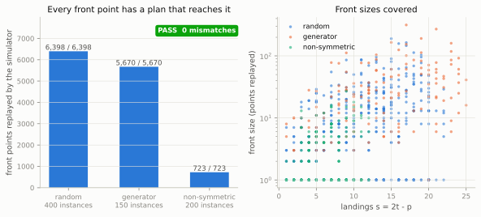{#fig-e1 .paper-fig}

## E2: the symmetric front {#sec-e2}

**Hypothesis.** Under (S) and (A1), every plan is weakly dominated by an admissible partition
(), so the Pareto front is the set of breakpoints of $E$
(), which ZenoSolver computes.

**Protocol.** Two exhaustive references. `truth` is a breadth-first search over all plans of the
planning problem, with no landing count, pattern or route shape assumed, flights between central
cities being absent or present but useless: 1,000 instances in each regime, with $n \le 3$,
$p \le 3$, $t \le \min(5, p + 3)$, $d \in [1, 6]$, $c \in [0, 9]$. `zenoOracle` enumerates every
role-configuration schedule with its exact waiting, at sizes `truth` cannot reach: 1,000
instances with $n \le 5$, $p \le 4$, $p < t \le 6$, $d \in [1, 20]$, $c \in [0, 30]$.

**Result.** 2,000 comparisons with all plans and 1,000 with the oracle; none differs, and no
reference timed out. Agreement with the search over all plans is the direct test of the converse:
no plan with extra landings, hand-offs or flights between central cities does better.
[Pass]{.verdict}

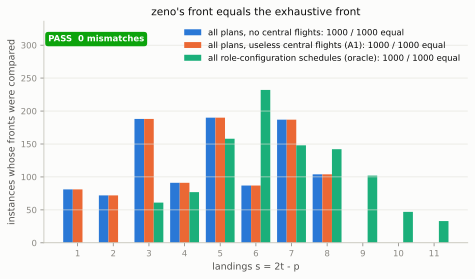{#fig-e2 .paper-fig}

## E3: the link-forest dynamic program {#sec-e3}

**Hypothesis.** The link-forest dynamic program returns $E(T)$ (), at
sizes where enumeration is out of reach.

**Protocol.** Two references share no code with the C++ solver. A CP-SAT model of $E(T)$, with
admissibility as a 0/1 parity matrix, checks that every front point $(C, M)$ has $E(M/2) = C$, that
the level just below the next point still costs $C$, and that the level below the fastest point
is infeasible, which pins the whole step function. The Lean solver `zeno-front` recomputes the
front from each certificate. The instances are 200 medium ones ($n \le 8$, $p \le 6$, $t \le 16$,
$d \le 40$, $c \le 60$) and 120 large ones ($n \le 12$, $p \le 10$, $t \le 28$, $d \le 80$).

**Result.** 23,346 levels over 320 instances (11,676 front points, up to 400 per front) agree
with CP-SAT, without timeout, and the Lean front equals the C++ one on all 320. On 37 instances
the certificate needed the `forest` bound, that is, $L < E$ at some level, the case where $E$ is
not given by the relaxation. [Pass]{.verdict}

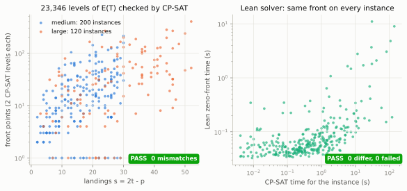{#fig-e3 .paper-fig}

## E4: the non-symmetric front {#sec-e4}

**Hypothesis.** Under (A1-NS), every plan is weakly dominated by a role configuration whose
template is no later (), so the Pareto front is the Pareto set of
(cost, least makespan) over role configurations (), and the bounds
and the search of ZenoSolver are sound.

**Protocol.** On tiny instances ($n \le 2$, $p \le 3$, $t \le \min(5, p + 3)$,
$d, \bar d \in [1, 6]$, $c \in [0, 6]$, up to $2t - p + 3$ landings), the search over all plans,
with flights between central cities absent or useless, is compared with the front of
role-configuration schedules with exact waiting, and with ZenoSolver whenever it closes its
bracket. On larger instances, 800 with $n \le 3$, $p \le 4$, $t \le 7$, half uniform and half
shaped like Proposition 6.5, the reference is the front of every simple plan with clean journeys,
any hand-offs and up to $2t - p + 1$ landings.

**Result.** 1,190 comparisons with all plans and 800 with all simple plans; none differs from the
role-configuration front. ZenoSolver closed its bracket on all 1,990 and matched the reference,
using the gap kinds `roles` (2,048 gaps), `balanced` (1,226), `lagrangian` (834), `relaxed` (91)
and `search` (37). [Pass]{.verdict}

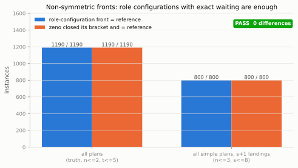{#fig-e4 .paper-fig}

## E5: harmful waiting {#sec-e5}

**Hypothesis.** If waiting could always be avoided (Conjecture 6.5), the Pareto front would be the
Pareto set of (cost, largest role load) over role configurations. 
says it is not.

**Protocol.** On the instance of Proposition 6.5, the front of all simple plans with waiting
ignored (makespan taken as the largest load) is compared with the exact fronts of the oracle, of
the role-configuration schedules and of ZenoSolver. At the configuration level, random balanced
role configurations under (AΔ-path), with a plane performing two patterns $\bar B$ and one
performing two patterns $B$, are scheduled with every order and matching. At the front level, on
300 random instances ($n \le 3$, $p \le 4$, $t \le 7$), half uniform and half shaped like
Proposition 6.5, the front with waiting is compared with the front without.

**Result.** Ignoring waiting gives the points $(14, 72)$ and $(30, 50)$, which no plan reaches:
the cheapest plan within makespan 73 costs 18, not 14, and the three exact methods agree.
Harmful waiting is rare among configurations: 1 in 900,143 with random crossing phases, 29 in
1,011,529 and 28 in 506,408 with one shortest crossing per plane. It changes the front of 9 of 150
instances shaped like Proposition 6.5 (95% interval 3.2% to 11.0%) and of none of 150 uniform ones
(0% to 2.5%). [Pass]{.verdict}

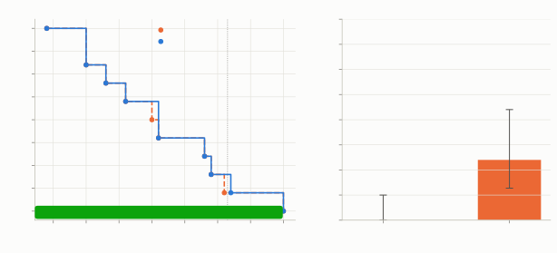{#fig-e5 .paper-fig}

## E6: the converse without (A1), a targeted search {#sec-e6}

**Hypothesis.** Under (S) and (AΔ), every plan is still weakly dominated by an admissible partition
(). A plan can beat the admissible-partition front only in a gap where
the relaxation $L$, valid for every plan, lies strictly below $E$: the gaps a certificate marks
`forest`.

**Protocol.** 100,000 random symmetric instances ($n \le 3$, $p \le 3$, $p < t \le 6$, durations
in $[1, 9]$, costs in $[1, 30]$) are drawn, and those with a `forest` gap are kept. Their true
front is computed by the search over all plans, with every flight between central cities as short
as the triangular inequality allows, $|d_a - d_b|$, and up to $2t - p + 2$ landings. A
counterexample is a plan inside a gap that costs less than $E$.

**Result.** 231 instances have a `forest` gap; in all 255 of their gaps, the cheapest plan costs
exactly $E$, and no search timed out. This search is independent of the proof of Theorem 4.10,
written and machine-checked. [Pass]{.verdict}

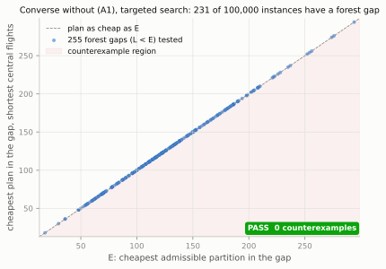{#fig-e6 .paper-fig}

## E7: performances {#sec-e7}

**Hypothesis.** The Pareto front is computable in pseudo-polynomial time
(): over the range of levels $[T_{\rm lo}, T_{\rm hi}]$, the
link-forest program takes $O(n\,q_{\max}^2 s^2\,T_{\rm hi}(T_{\rm hi} - T_{\rm lo} + 1))$ time, so
the time should grow at most quadratically with the number of levels.

**Protocol.** Sweeps of one parameter at a time, median of 3 runs: the duration scale `-r` on
the square-root family ($n = 20$, $t = 12$, $p = 4$), whose number of levels grows with `-r`, and
$n$, $t$ and $p$. Then single runs on a grid of $(n, t, p)$ with a timeout of 60 s. Every run uses
all 16 cores. Other jobs shared the machine (load average 18.6 to 38.8), so the times are upper
bounds.

**Result.** On the duration sweep, from 16 to 173,606 levels, the time grows as the number of
levels to the power 0.39, below the degree 2 of the bound. 16 of the 24 grid points finished
within 60 s, the largest being $n = 1000$, $t = 100$, $p = 10$, in 59 s with 18,982 front points;
others include $n = 5000$, $t = 20$, $p = 4$ (31 s) and $n = 100$, $t = 500$, $p = 50$ (17 s).
Instances such as $n = 500$, $t = 200$, $p = 20$ or $n = 100$, $t = 1000$, $p = 10$ timed out.
The time is not monotone in $p$: for $n = 50$ and $t = 60$ it was 3.5 s with $p = 2$, 1.0 s with
$p = 5$, 9.1 s with $p = 10$, 114 s with $p = 20$ and 0.04 s with $p = 40$. As $p$ grows, the
number of levels shrinks, from 35,814 to 1,215, while the trees of a link forest may have up to
$q_{\max} = \min(p, t - p + 1)$ planes. [Pass]{.verdict}

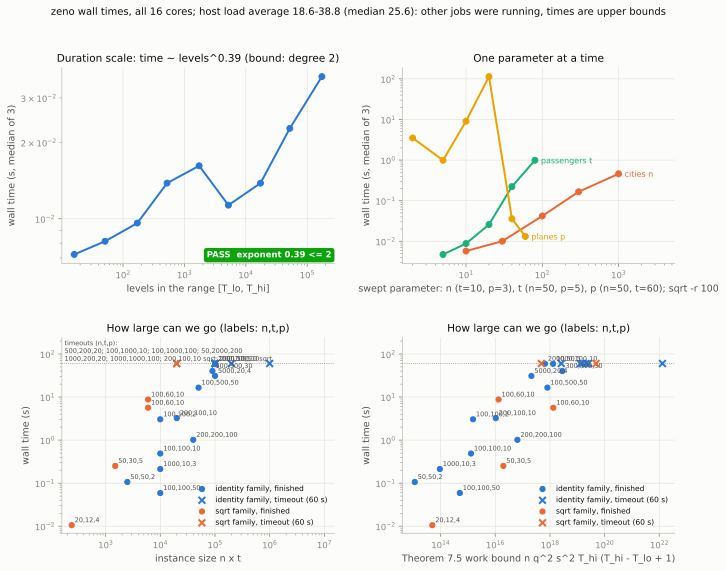{#fig-e7 .paper-fig}

## Performances on the benchmark suites {#sec-bench}

The repository also times ZenoSolver end to end on fixed suites of instances
([`bench/`](https://github.com/aquemy/ZenoSolver/blob/master/bench/README.md)): an Apple M4 Max
with 16 cores, all cores used, median of 3 runs and a timeout of 30 s per run. All 66 instances
are solved, the slowest in 61 ms. Process start-up takes about 3 ms, the floor of every timing.

In @tbl-table1, we report the time to solve an instance when increasing simultaneously $n$ and
$t$ with two planes, on the default generator, $d_i = i$ and $c_i = n + 1 - i$. This is the linear
family, so the size of the Pareto front is known in advance: with $2t - p = 2n - 2$ landings and
$\kappa = n - 1$, Theorem 10.1 gives $(n - 1)\kappa + 1 = (n - 1)^2 + 1$ points, which the solver
finds on every instance.

| $n$ | $t$ | $p$ | Front size | $(n - 1)^2 + 1$ | Time |
|---|---|---|---|---|---|
| 3 | 3 | 2 | 5 | 5 | 2.2 ms |
| 4 | 4 | 2 | 10 | 10 | 2.2 ms |
| 5 | 5 | 2 | 17 | 17 | 2.2 ms |
| 6 | 6 | 2 | 26 | 26 | 2.1 ms |
| 7 | 7 | 2 | 37 | 37 | 3.3 ms |
| 8 | 8 | 2 | 50 | 50 | 2.1 ms |
| 9 | 9 | 2 | 65 | 65 | 2.1 ms |
| 10 | 10 | 2 | 82 | 82 | 2.1 ms |

: Increasing simultaneously $n$ and $t$ with $d_i = i$ and $c_i = n + 1 - i$ (suite `paper-table1`). {#tbl-table1}

Larger instances of the same family, and the generator's other families on $n = 10$, $t = 8$,
$p = 3$ (with `-r 100` for the logarithm and the square root), behave alike (@tbl-regimes).

| Instance | $n$ | $t$ | $p$ | Front size | Time |
|---|---|---|---|---|---|
| many cities, few passengers | 200 | 3 | 2 | 399 | 3.7 ms |
| balanced | 20 | 6 | 2 | 96 | 3.6 ms |
| $p$ close to $t$ | 8 | 26 | 25 | 15 | 3.4 ms |
| medium | 50 | 30 | 5 | 540 | 8.1 ms |
| large | 100 | 60 | 10 | 1,090 | 60.6 ms |
| logarithmic durations and costs | 10 | 8 | 3 | 46 | 3.7 ms |
| square-root durations and costs | 10 | 8 | 3 | 81 | 3.7 ms |
| powers of two | 10 | 8 | 3 | 46 | 5.0 ms |
| staircase | 10 | 8 | 3 | 133 | 3.7 ms |

: The five regimes of the suite `regimes`, all of the linear family, and four families of the suite `families`. {#tbl-regimes}

## E8: certificates {#sec-e8}

**Hypothesis.** A certificate whose four obligations hold lists exactly the Pareto front
(), so a sound checker never accepts a false front.

**Protocol.** Both checkers, `zeno check` in C++ and `zeno-check` in Lean, are run on the 41
certificates of the test corpus, on 700 fresh certificates (400 symmetric, format version 1, and
300 non-symmetric, version 2), and on mutants of the 722 accepted ones: a point dropped, a cost or
a makespan lowered, a flight shifted, a passenger changed, a gap weakened to `relaxed`, an
assumption dropped. A mutant must be rejected when its front differs from the true one, when one
of its plans fails the simulator, or when it lacks an assumption that one of its bounds needs.

**Result.** Both checkers give the expected verdict on the corpus and accept every fresh
certificate. Of 4,056 mutants, 3,904 had to be rejected, and neither checker accepted any of them;
the two checkers never disagree. [Pass]{.verdict}

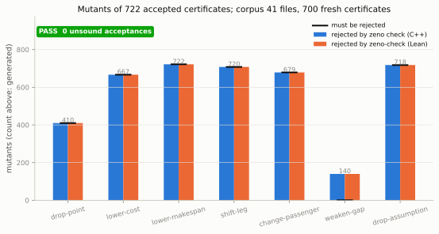{#fig-e8 .paper-fig}

## E9: the linear family {#sec-e9}

**Hypothesis.** On the linear family of the default generator, the Pareto front has the closed
form of  (see [below](#sec-examples)), and $L = E$ at every level, so it
holds whatever the flights between central cities.

**Protocol.** 300 data files with $d_i = r_0 i$ ($r_0 \le 7$) and $c_i = \alpha - \beta i$
($\beta \le 6$, zero for 10% of them, $\alpha \in [\beta n, \beta n + 40]$), $n \le 30$,
$p \le 8$, $t \le 25$; and 300 generator instances `-C 3 -D 3` with `-r` 1 or 10, $n \le 40$,
$p \le 10$, $t \le 30$, plus three larger instances.

**Result.** 603 instances and 92,550 front points, the largest front having 1,939 points, all
equal to the closed form; no certificate needed the `forest` bound. The front sizes 1,090
($n = 100$, $t = 60$, $p = 10$), 540 ($n = 50$, same $t$ and $p$) and 399 ($n = 200$, $t = 3$,
$p = 2$) are reproduced. [Pass]{.verdict}

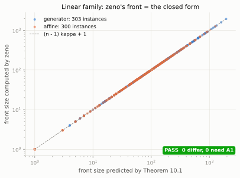{#fig-e9 .paper-fig}

## E10: a natural greedy heuristic {#sec-e10}

**Hypothesis.** A natural heuristic computes the makespan of each list of $2t - p$ cities
greedily, giving the longest durations first to the plane with the smallest current duration, in
the manner of the longest-processing-time rule. It is not exact in general (),
and Conjecture 10.2 states that it is exact on the linear family. How often is it exact?

**Protocol.** `greedy.cpp` implements the heuristic and shares no code with the exact solver. It
is first validated on the 27 golden instances: it must differ from the golden fronts exactly on
the two instances on which it is known to fail, `lpt-counterexample` and `n3t5p2-C1D4r10`, where
it misses the point $(260, 60)$. Then, on a grid with $2 \le n \le 8$, $2 \le t \le 10$ and
$1 \le p \le \min(t, 6)$, each cell holds three random instances with uniform costs, three with
anti-correlated costs, three of the generator's non-linear families, and three of the linear
family; the greedy front is compared with the exact one.

**Result.** Outside the linear family, the greedy is exact on 2,274 of 2,772 instances (82.0%,
95% interval 80.6% to 83.4%) and finds 93.9% of the front points. With $p = 1$ or $t - p \le 2$ it
is exact on all 1,512 instances; every miss in the sample has $p \ge 2$ and $t - p \ge 3$, an
observation rather than a claim. On the linear family it is exact on 924 of 924 instances (95%
interval 99.6% to 100%), evidence for Conjecture 10.2 but not a proof. No greedy point beats the
exact front. [Pass]{.verdict}

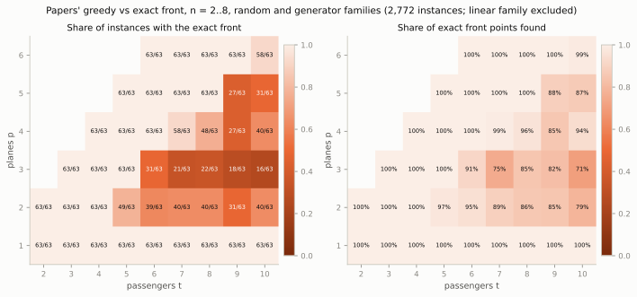{#fig-e10a .paper-fig}

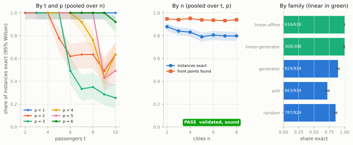{#fig-e10b .paper-fig}

## Examples of Instances {#sec-examples}

In @fig-fronts, we display some examples of the variety of Pareto Fronts that it is possible to
obtain by modifying the functions to generate $d$ and $c$, on symmetric instances with $n = 7$,
$t = 8$ and $p = 3$, for which the fronts are exact. The top left picture shows regular patterns
with a uniform disposition of points. This instance is obtained with a logarithmic cost and
linear durations. The top right figure is obtained by using square-root durations and displays a
less regular point distribution over the front. By using slightly more complex combination of
generators, it is possible to obtain non-regular fronts with non-uniform distribution such as the
bottom two figures: on the left, costs $2^i$ and logarithmic durations, while on the right,
durations in a staircase, whose points come in clusters.

::: {#fig-fronts}

```{=html}
<svg class="zs-fronts" viewBox="0 0 640 470" role="img" aria-label="Pareto fronts of four generated instances with n = 7, t = 8, p = 3" xmlns="http://www.w3.org/2000/svg">
<text class="ptitle" x="50" y="22">-C 1 -D 3: 31 points</text>
<line class="axis" x1="50" y1="194" x2="296" y2="194"/>
<line class="axis" x1="50" y1="36" x2="50" y2="194"/>
<text class="tick" x="50" y="208" text-anchor="middle">100</text>
<text class="tick" x="296" y="208" text-anchor="middle">700</text>
<text class="tick" x="45" y="198" text-anchor="end">0</text>
<text class="tick" x="45" y="40" text-anchor="end">243</text>
<text class="axlbl" x="173.0" y="220" text-anchor="middle">makespan</text>
<text class="axlbl" x="18" y="115.0" text-anchor="middle" transform="rotate(-90 18 115.0)">cost</text>
<path class="stair" d="M 50.0 36.0 H 58.2 V 41.9 H 66.4 V 48.4 H 74.6 V 54.2 H 82.8 V 60.7 H 91.0 V 66.6 H 99.2 V 73.1 H 107.4 V 77.6 H 115.6 V 82.8 H 123.8 V 91.3 H 132.0 V 97.8 H 140.2 V 103.6 H 148.4 V 110.1 H 156.6 V 114.0 H 164.8 V 119.2 H 173.0 V 125.7 H 181.2 V 134.8 H 189.4 V 140.7 H 197.6 V 147.2 H 205.8 V 149.8 H 214.0 V 155.0 H 222.2 V 160.2 H 230.4 V 167.3 H 238.6 V 177.7 H 246.8 V 181.6 H 255.0 V 182.9 H 263.2 V 183.6 H 271.4 V 185.5 H 279.6 V 187.5 H 287.8 V 190.1 H 296.0 V 194.0"/>
<circle class="pt" cx="296.0" cy="194.0" r="2.4"/>
<circle class="pt" cx="287.8" cy="190.1" r="2.4"/>
<circle class="pt" cx="279.6" cy="187.5" r="2.4"/>
<circle class="pt" cx="271.4" cy="185.5" r="2.4"/>
<circle class="pt" cx="263.2" cy="183.6" r="2.4"/>
<circle class="pt" cx="255.0" cy="182.9" r="2.4"/>
<circle class="pt" cx="246.8" cy="181.6" r="2.4"/>
<circle class="pt" cx="238.6" cy="177.7" r="2.4"/>
<circle class="pt" cx="230.4" cy="167.3" r="2.4"/>
<circle class="pt" cx="222.2" cy="160.2" r="2.4"/>
<circle class="pt" cx="214.0" cy="155.0" r="2.4"/>
<circle class="pt" cx="205.8" cy="149.8" r="2.4"/>
<circle class="pt" cx="197.6" cy="147.2" r="2.4"/>
<circle class="pt" cx="189.4" cy="140.7" r="2.4"/>
<circle class="pt" cx="181.2" cy="134.8" r="2.4"/>
<circle class="pt" cx="173.0" cy="125.7" r="2.4"/>
<circle class="pt" cx="164.8" cy="119.2" r="2.4"/>
<circle class="pt" cx="156.6" cy="114.0" r="2.4"/>
<circle class="pt" cx="148.4" cy="110.1" r="2.4"/>
<circle class="pt" cx="140.2" cy="103.6" r="2.4"/>
<circle class="pt" cx="132.0" cy="97.8" r="2.4"/>
<circle class="pt" cx="123.8" cy="91.3" r="2.4"/>
<circle class="pt" cx="115.6" cy="82.8" r="2.4"/>
<circle class="pt" cx="107.4" cy="77.6" r="2.4"/>
<circle class="pt" cx="99.2" cy="73.1" r="2.4"/>
<circle class="pt" cx="91.0" cy="66.6" r="2.4"/>
<circle class="pt" cx="82.8" cy="60.7" r="2.4"/>
<circle class="pt" cx="74.6" cy="54.2" r="2.4"/>
<circle class="pt" cx="66.4" cy="48.4" r="2.4"/>
<circle class="pt" cx="58.2" cy="41.9" r="2.4"/>
<circle class="pt" cx="50.0" cy="36.0" r="2.4"/>
<text class="ptitle" x="368" y="22">-C 3 -D 2: 41 points</text>
<line class="axis" x1="368" y1="194" x2="614" y2="194"/>
<line class="axis" x1="368" y1="36" x2="368" y2="194"/>
<text class="tick" x="368" y="208" text-anchor="middle">100</text>
<text class="tick" x="614" y="208" text-anchor="middle">260</text>
<text class="tick" x="363" y="198" text-anchor="end">130</text>
<text class="tick" x="363" y="40" text-anchor="end">840</text>
<text class="axlbl" x="491.0" y="220" text-anchor="middle">makespan</text>
<text class="axlbl" x="336" y="115.0" text-anchor="middle" transform="rotate(-90 336 115.0)">cost</text>
<path class="stair" d="M 368.0 36.0 H 374.1 V 38.2 H 380.3 V 44.9 H 386.4 V 49.4 H 389.5 V 51.6 H 398.8 V 60.5 H 404.9 V 64.9 H 411.1 V 69.4 H 417.2 V 76.1 H 423.4 V 78.3 H 429.5 V 85.0 H 435.6 V 89.4 H 438.7 V 91.6 H 441.8 V 93.9 H 447.9 V 100.5 H 454.1 V 105.0 H 460.2 V 109.4 H 466.4 V 113.9 H 472.6 V 118.3 H 478.7 V 125.0 H 484.9 V 129.5 H 487.9 V 131.7 H 497.1 V 138.4 H 503.3 V 140.6 H 506.4 V 145.0 H 509.4 V 147.3 H 515.6 V 153.9 H 521.8 V 158.4 H 527.9 V 165.1 H 534.0 V 169.5 H 537.1 V 171.7 H 546.4 V 174.0 H 552.5 V 176.2 H 558.6 V 178.4 H 564.8 V 180.6 H 577.1 V 182.9 H 586.3 V 185.1 H 595.5 V 187.3 H 601.7 V 189.5 H 607.9 V 191.8 H 614.0 V 194.0"/>
<circle class="pt" cx="614.0" cy="194.0" r="2.4"/>
<circle class="pt" cx="607.9" cy="191.8" r="2.4"/>
<circle class="pt" cx="601.7" cy="189.5" r="2.4"/>
<circle class="pt" cx="595.5" cy="187.3" r="2.4"/>
<circle class="pt" cx="586.3" cy="185.1" r="2.4"/>
<circle class="pt" cx="577.1" cy="182.9" r="2.4"/>
<circle class="pt" cx="564.8" cy="180.6" r="2.4"/>
<circle class="pt" cx="558.6" cy="178.4" r="2.4"/>
<circle class="pt" cx="552.5" cy="176.2" r="2.4"/>
<circle class="pt" cx="546.4" cy="174.0" r="2.4"/>
<circle class="pt" cx="537.1" cy="171.7" r="2.4"/>
<circle class="pt" cx="534.0" cy="169.5" r="2.4"/>
<circle class="pt" cx="527.9" cy="165.1" r="2.4"/>
<circle class="pt" cx="521.8" cy="158.4" r="2.4"/>
<circle class="pt" cx="515.6" cy="153.9" r="2.4"/>
<circle class="pt" cx="509.4" cy="147.3" r="2.4"/>
<circle class="pt" cx="506.4" cy="145.0" r="2.4"/>
<circle class="pt" cx="503.3" cy="140.6" r="2.4"/>
<circle class="pt" cx="497.1" cy="138.4" r="2.4"/>
<circle class="pt" cx="487.9" cy="131.7" r="2.4"/>
<circle class="pt" cx="484.9" cy="129.5" r="2.4"/>
<circle class="pt" cx="478.7" cy="125.0" r="2.4"/>
<circle class="pt" cx="472.6" cy="118.3" r="2.4"/>
<circle class="pt" cx="466.4" cy="113.9" r="2.4"/>
<circle class="pt" cx="460.2" cy="109.4" r="2.4"/>
<circle class="pt" cx="454.1" cy="105.0" r="2.4"/>
<circle class="pt" cx="447.9" cy="100.5" r="2.4"/>
<circle class="pt" cx="441.8" cy="93.9" r="2.4"/>
<circle class="pt" cx="438.7" cy="91.6" r="2.4"/>
<circle class="pt" cx="435.6" cy="89.4" r="2.4"/>
<circle class="pt" cx="429.5" cy="85.0" r="2.4"/>
<circle class="pt" cx="423.4" cy="78.3" r="2.4"/>
<circle class="pt" cx="417.2" cy="76.1" r="2.4"/>
<circle class="pt" cx="411.1" cy="69.4" r="2.4"/>
<circle class="pt" cx="404.9" cy="64.9" r="2.4"/>
<circle class="pt" cx="398.8" cy="60.5" r="2.4"/>
<circle class="pt" cx="389.5" cy="51.6" r="2.4"/>
<circle class="pt" cx="386.4" cy="49.4" r="2.4"/>
<circle class="pt" cx="380.3" cy="44.9" r="2.4"/>
<circle class="pt" cx="374.1" cy="38.2" r="2.4"/>
<circle class="pt" cx="368.0" cy="36.0" r="2.4"/>
<text class="ptitle" x="50" y="254">-C 4 -D 1: 59 points</text>
<line class="axis" x1="50" y1="426" x2="296" y2="426"/>
<line class="axis" x1="50" y1="268" x2="50" y2="426"/>
<text class="tick" x="50" y="440" text-anchor="middle">0</text>
<text class="tick" x="296" y="440" text-anchor="middle">190</text>
<text class="tick" x="45" y="430" text-anchor="end">260</text>
<text class="tick" x="45" y="272" text-anchor="end">16640</text>
<text class="axlbl" x="173.0" y="452" text-anchor="middle">makespan</text>
<text class="axlbl" x="18" y="347.0" text-anchor="middle" transform="rotate(-90 18 347.0)">cost</text>
<path class="stair" d="M 50.0 268.0 H 65.5 V 286.5 H 75.9 V 295.8 H 81.1 V 305.0 H 91.4 V 314.3 H 96.6 V 323.6 H 107.0 V 332.8 H 112.1 V 342.1 H 122.5 V 351.3 H 127.7 V 357.5 H 132.9 V 360.6 H 138.0 V 365.2 H 140.6 V 366.8 H 143.2 V 369.9 H 145.8 V 371.4 H 148.4 V 372.9 H 151.0 V 376.0 H 153.6 V 379.1 H 156.2 V 380.7 H 158.8 V 382.2 H 161.3 V 385.3 H 166.5 V 386.8 H 169.1 V 391.5 H 176.9 V 396.1 H 179.5 V 397.6 H 184.7 V 400.7 H 187.2 V 402.3 H 192.4 V 403.8 H 195.0 V 406.1 H 200.2 V 406.9 H 202.8 V 409.2 H 205.4 V 410.0 H 210.5 V 412.3 H 213.1 V 413.1 H 215.7 V 413.8 H 218.3 V 415.4 H 220.9 V 416.2 H 223.5 V 416.9 H 226.1 V 418.5 H 228.7 V 418.9 H 231.3 V 419.2 H 233.9 V 419.6 H 236.4 V 420.4 H 239.0 V 420.8 H 241.6 V 421.2 H 244.2 V 421.6 H 246.8 V 422.3 H 249.4 V 422.7 H 254.6 V 423.1 H 257.2 V 423.5 H 259.7 V 423.9 H 264.9 V 424.3 H 267.5 V 424.6 H 270.1 V 425.0 H 275.3 V 425.2 H 280.5 V 425.4 H 285.6 V 425.6 H 290.8 V 425.8 H 296.0 V 426.0"/>
<circle class="pt" cx="296.0" cy="426.0" r="2.4"/>
<circle class="pt" cx="290.8" cy="425.8" r="2.4"/>
<circle class="pt" cx="285.6" cy="425.6" r="2.4"/>
<circle class="pt" cx="280.5" cy="425.4" r="2.4"/>
<circle class="pt" cx="275.3" cy="425.2" r="2.4"/>
<circle class="pt" cx="270.1" cy="425.0" r="2.4"/>
<circle class="pt" cx="267.5" cy="424.6" r="2.4"/>
<circle class="pt" cx="264.9" cy="424.3" r="2.4"/>
<circle class="pt" cx="259.7" cy="423.9" r="2.4"/>
<circle class="pt" cx="257.2" cy="423.5" r="2.4"/>
<circle class="pt" cx="254.6" cy="423.1" r="2.4"/>
<circle class="pt" cx="249.4" cy="422.7" r="2.4"/>
<circle class="pt" cx="246.8" cy="422.3" r="2.4"/>
<circle class="pt" cx="244.2" cy="421.6" r="2.4"/>
<circle class="pt" cx="241.6" cy="421.2" r="2.4"/>
<circle class="pt" cx="239.0" cy="420.8" r="2.4"/>
<circle class="pt" cx="236.4" cy="420.4" r="2.4"/>
<circle class="pt" cx="233.9" cy="419.6" r="2.4"/>
<circle class="pt" cx="231.3" cy="419.2" r="2.4"/>
<circle class="pt" cx="228.7" cy="418.9" r="2.4"/>
<circle class="pt" cx="226.1" cy="418.5" r="2.4"/>
<circle class="pt" cx="223.5" cy="416.9" r="2.4"/>
<circle class="pt" cx="220.9" cy="416.2" r="2.4"/>
<circle class="pt" cx="218.3" cy="415.4" r="2.4"/>
<circle class="pt" cx="215.7" cy="413.8" r="2.4"/>
<circle class="pt" cx="213.1" cy="413.1" r="2.4"/>
<circle class="pt" cx="210.5" cy="412.3" r="2.4"/>
<circle class="pt" cx="205.4" cy="410.0" r="2.4"/>
<circle class="pt" cx="202.8" cy="409.2" r="2.4"/>
<circle class="pt" cx="200.2" cy="406.9" r="2.4"/>
<circle class="pt" cx="195.0" cy="406.1" r="2.4"/>
<circle class="pt" cx="192.4" cy="403.8" r="2.4"/>
<circle class="pt" cx="187.2" cy="402.3" r="2.4"/>
<circle class="pt" cx="184.7" cy="400.7" r="2.4"/>
<circle class="pt" cx="179.5" cy="397.6" r="2.4"/>
<circle class="pt" cx="176.9" cy="396.1" r="2.4"/>
<circle class="pt" cx="169.1" cy="391.5" r="2.4"/>
<circle class="pt" cx="166.5" cy="386.8" r="2.4"/>
<circle class="pt" cx="161.3" cy="385.3" r="2.4"/>
<circle class="pt" cx="158.8" cy="382.2" r="2.4"/>
<circle class="pt" cx="156.2" cy="380.7" r="2.4"/>
<circle class="pt" cx="153.6" cy="379.1" r="2.4"/>
<circle class="pt" cx="151.0" cy="376.0" r="2.4"/>
<circle class="pt" cx="148.4" cy="372.9" r="2.4"/>
<circle class="pt" cx="145.8" cy="371.4" r="2.4"/>
<circle class="pt" cx="143.2" cy="369.9" r="2.4"/>
<circle class="pt" cx="140.6" cy="366.8" r="2.4"/>
<circle class="pt" cx="138.0" cy="365.2" r="2.4"/>
<circle class="pt" cx="132.9" cy="360.6" r="2.4"/>
<circle class="pt" cx="127.7" cy="357.5" r="2.4"/>
<circle class="pt" cx="122.5" cy="351.3" r="2.4"/>
<circle class="pt" cx="112.1" cy="342.1" r="2.4"/>
<circle class="pt" cx="107.0" cy="332.8" r="2.4"/>
<circle class="pt" cx="96.6" cy="323.6" r="2.4"/>
<circle class="pt" cx="91.4" cy="314.3" r="2.4"/>
<circle class="pt" cx="81.1" cy="305.0" r="2.4"/>
<circle class="pt" cx="75.9" cy="295.8" r="2.4"/>
<circle class="pt" cx="65.5" cy="286.5" r="2.4"/>
<circle class="pt" cx="50.0" cy="268.0" r="2.4"/>
<text class="ptitle" x="368" y="254">-C 3 -D 5: 52 points</text>
<line class="axis" x1="368" y1="426" x2="614" y2="426"/>
<line class="axis" x1="368" y1="268" x2="368" y2="426"/>
<text class="tick" x="368" y="440" text-anchor="middle">10</text>
<text class="tick" x="614" y="440" text-anchor="middle">1510</text>
<text class="tick" x="363" y="430" text-anchor="end">130</text>
<text class="tick" x="363" y="272" text-anchor="end">910</text>
<text class="axlbl" x="491.0" y="452" text-anchor="middle">makespan</text>
<text class="axlbl" x="336" y="347.0" text-anchor="middle" transform="rotate(-90 336 347.0)">cost</text>
<path class="stair" d="M 368.0 268.0 H 382.8 V 272.1 H 383.1 V 276.1 H 384.1 V 278.1 H 384.4 V 280.2 H 399.2 V 284.2 H 399.5 V 288.3 H 400.5 V 290.3 H 400.8 V 292.3 H 415.6 V 296.4 H 415.9 V 300.4 H 416.9 V 302.4 H 417.2 V 304.5 H 432.3 V 308.5 H 432.6 V 312.6 H 433.3 V 314.6 H 433.6 V 316.6 H 448.7 V 320.7 H 449.0 V 324.7 H 449.7 V 326.7 H 450.0 V 328.8 H 465.1 V 332.8 H 465.4 V 336.9 H 466.1 V 338.9 H 466.4 V 340.9 H 481.8 V 345.0 H 482.1 V 349.0 H 482.5 V 351.1 H 482.8 V 353.1 H 498.2 V 357.1 H 498.5 V 361.2 H 498.9 V 363.2 H 499.2 V 365.2 H 514.6 V 369.3 H 514.9 V 373.3 H 515.3 V 375.4 H 515.6 V 377.4 H 531.3 V 381.4 H 531.7 V 387.5 H 532.0 V 389.5 H 547.7 V 393.6 H 548.1 V 399.7 H 548.4 V 401.7 H 564.1 V 405.7 H 564.5 V 411.8 H 564.8 V 413.8 H 580.9 V 415.9 H 581.2 V 417.9 H 597.3 V 419.9 H 597.6 V 421.9 H 613.7 V 424.0 H 614.0 V 426.0"/>
<circle class="pt" cx="614.0" cy="426.0" r="2.4"/>
<circle class="pt" cx="613.7" cy="424.0" r="2.4"/>
<circle class="pt" cx="597.6" cy="421.9" r="2.4"/>
<circle class="pt" cx="597.3" cy="419.9" r="2.4"/>
<circle class="pt" cx="581.2" cy="417.9" r="2.4"/>
<circle class="pt" cx="580.9" cy="415.9" r="2.4"/>
<circle class="pt" cx="564.8" cy="413.8" r="2.4"/>
<circle class="pt" cx="564.5" cy="411.8" r="2.4"/>
<circle class="pt" cx="564.1" cy="405.7" r="2.4"/>
<circle class="pt" cx="548.4" cy="401.7" r="2.4"/>
<circle class="pt" cx="548.1" cy="399.7" r="2.4"/>
<circle class="pt" cx="547.7" cy="393.6" r="2.4"/>
<circle class="pt" cx="532.0" cy="389.5" r="2.4"/>
<circle class="pt" cx="531.7" cy="387.5" r="2.4"/>
<circle class="pt" cx="531.3" cy="381.4" r="2.4"/>
<circle class="pt" cx="515.6" cy="377.4" r="2.4"/>
<circle class="pt" cx="515.3" cy="375.4" r="2.4"/>
<circle class="pt" cx="514.9" cy="373.3" r="2.4"/>
<circle class="pt" cx="514.6" cy="369.3" r="2.4"/>
<circle class="pt" cx="499.2" cy="365.2" r="2.4"/>
<circle class="pt" cx="498.9" cy="363.2" r="2.4"/>
<circle class="pt" cx="498.5" cy="361.2" r="2.4"/>
<circle class="pt" cx="498.2" cy="357.1" r="2.4"/>
<circle class="pt" cx="482.8" cy="353.1" r="2.4"/>
<circle class="pt" cx="482.5" cy="351.1" r="2.4"/>
<circle class="pt" cx="482.1" cy="349.0" r="2.4"/>
<circle class="pt" cx="481.8" cy="345.0" r="2.4"/>
<circle class="pt" cx="466.4" cy="340.9" r="2.4"/>
<circle class="pt" cx="466.1" cy="338.9" r="2.4"/>
<circle class="pt" cx="465.4" cy="336.9" r="2.4"/>
<circle class="pt" cx="465.1" cy="332.8" r="2.4"/>
<circle class="pt" cx="450.0" cy="328.8" r="2.4"/>
<circle class="pt" cx="449.7" cy="326.7" r="2.4"/>
<circle class="pt" cx="449.0" cy="324.7" r="2.4"/>
<circle class="pt" cx="448.7" cy="320.7" r="2.4"/>
<circle class="pt" cx="433.6" cy="316.6" r="2.4"/>
<circle class="pt" cx="433.3" cy="314.6" r="2.4"/>
<circle class="pt" cx="432.6" cy="312.6" r="2.4"/>
<circle class="pt" cx="432.3" cy="308.5" r="2.4"/>
<circle class="pt" cx="417.2" cy="304.5" r="2.4"/>
<circle class="pt" cx="416.9" cy="302.4" r="2.4"/>
<circle class="pt" cx="415.9" cy="300.4" r="2.4"/>
<circle class="pt" cx="415.6" cy="296.4" r="2.4"/>
<circle class="pt" cx="400.8" cy="292.3" r="2.4"/>
<circle class="pt" cx="400.5" cy="290.3" r="2.4"/>
<circle class="pt" cx="399.5" cy="288.3" r="2.4"/>
<circle class="pt" cx="399.2" cy="284.2" r="2.4"/>
<circle class="pt" cx="384.4" cy="280.2" r="2.4"/>
<circle class="pt" cx="384.1" cy="278.1" r="2.4"/>
<circle class="pt" cx="383.1" cy="276.1" r="2.4"/>
<circle class="pt" cx="382.8" cy="272.1" r="2.4"/>
<circle class="pt" cx="368.0" cy="268.0" r="2.4"/>
</svg>
```

Pareto fronts computed by ZenoSolver for $n = 7$, $t = 8$, $p = 3$ and `-r 10`, with four
generators of costs (`-C`) and durations (`-D`): logarithmic costs and linear durations (top
left), linear costs and square-root durations (top right), costs $2^i$ and logarithmic durations
(bottom left), linear costs and durations in a staircase (bottom right). Each panel spans its own
ranges of cost (vertical) and makespan (horizontal).
:::

With its default options (`-C 3 -D 3`), the generator produces durations $d_i = r_0 i$ and costs
$c_i = r_0(n + 1 - i)$: cost is affine and decreasing in duration, and the durations form the
full progression $r_0, 2r_0, \dots, n r_0$. Dividing the durations by $r_0$ gives $d_i = i$ and
$c_i = \alpha - \beta i$ with $\alpha = r_0(n + 1)$ and $\beta = r_0$, and the Pareto front then
has a closed form.

::: {.statement}
 Assume (S), $d_i = i$ and $c_i = \alpha - \beta i$ for
$i = 1, \dots, n$, with $\beta \ge 0$ and $\alpha \ge \beta n$. Let $s = 2t - p$,
$q_0 = \lfloor s/p \rfloor$ and $\rho = s - p q_0$. For every integer $T \ge \kappa$,
$$L(T) = E(T) = \alpha s - \beta\,\Psi(T), \qquad \Psi(T) = (p - \rho)\min(T,\ n q_0) + \rho\min(T,\ n(q_0 + 1)),$$
and $L(T) = E(T) = \infty$ for $T < \kappa$. Whatever the flights between central cities, the
Pareto front is
$$\mathcal F = \{(\alpha s - \beta\,\Psi(T),\ 2T) : \kappa \le T \le n\kappa\} \text{ if } \beta > 0, \qquad \mathcal F = \{(\alpha s,\ 2\kappa)\} \text{ if } \beta = 0,$$
with makespans in units of $r_0$. For $\beta > 0$ it has $(n - 1)\kappa + 1$ points.
:::

(The theory note writes $\Phi$ for $\Psi$.)

::: {.sketch}
*Sketch.* With affine costs, the cheapest group of $m$ landings within $T$ costs
$\alpha m - \beta\min(T, nm)$, which is convex in $m$, so balanced group sizes $q_0$ and $q_0 + 1$
minimise $L$; giving equal groups the same cities makes all even groups equal, which is admissible
by , so $L = E$. As $L$ bounds every plan under (S) alone
(), no assumption on central flights is needed
().
:::

The theorem does not cover offset progressions $d_i = a + bi$ with $a > 0$, on which $L < E$
occurs (for $d = (5, 7, 9, 11)$, $c_i = 24 - 2 d_i$, $t = 7$, $p = 4$:
$L(20) = 80 < E(20) = 84$), nor the generator's other families, which have no closed form and are
solved by the general algorithm. On the linear family, the greedy heuristic of E10 also appears to
be exact:

::: {.statement}
 The greedy heuristic of  reaches the
front of Theorem 10.1.
:::

It is open; the theory note reports equal fronts on 115 instances, and E10 on 924 more.
Correctness does not depend on it, since the front is in closed form.
