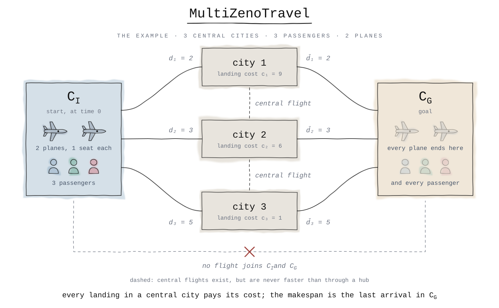
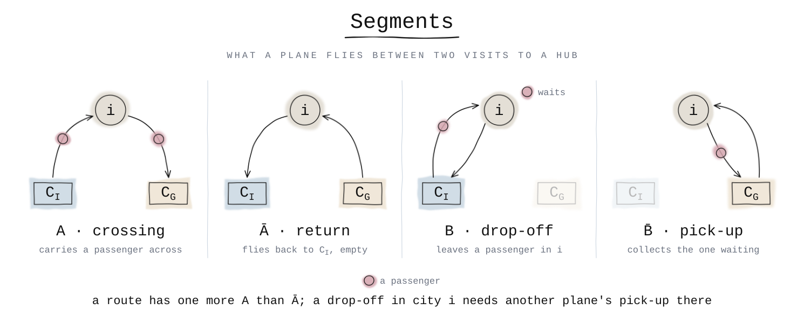

<!-- The example instance, its front and its plans come from zeno: site/gen_problem.py writes
     site/problem/plans.json and site/_problem-example.md. The figure site/images/multizenotravel.svg
     is drawn for the same instance (site/problem/example.dat). -->

MultiZenoTravel is a planning problem with two objectives. Planes carry passengers from a start
hub to a goal hub through intermediate cities. Each landing in an intermediate city has a price,
and the cheap cities are the far ones. A plan is judged on its **cost**, the sum of its landing
prices, and on its **makespan**, the time at which the last plane reaches the goal. No plan is best
on both counts, so the answer is a **Pareto front**: every (cost, makespan) pair that some plan
achieves and that no other plan matches or beats on both. ZenoSolver computes it exactly.

## The model {#model}

::: {.column-page-inset-right .zs-figure}
{.lightbox fig-alt="Two hubs, C_I on the left with two planes and three passengers, C_G on the right where everyone must end. Three central cities in between, each joined to both hubs by a flight with its duration, and each with a landing cost. Dashed lines join neighbouring central cities. A crossed-out dashed line shows that no flight joins C_I and C_G."}
:::

- **Cities.** Two hubs, $C_I$ where everything starts and $C_G$ where everything must end, and $n$
  central cities $1, \dots, n$.
- **Flights.** Central city $i$ is joined to $C_I$ by a flight of duration $d_i$ and to $C_G$ by a
  flight of duration $\bar d_i$; flights can be flown both ways. No flight joins $C_I$ and $C_G$,
  so every trip lands in a central city. Two central cities may be joined. In the instances zeno
  generates by default, as in the example, such a flight is never faster than going through a hub
  (assumption (A1)); in metric instances every flight lasts the distance between its ends, so the
  durations satisfy the triangle inequality instead (assumption (AΔ), ). The
  instance is *symmetric* when $\bar d_i = d_i$ for every city.
- **Cost.** Landing in central city $i$ costs $c_i$. Landing in a hub is free.
- **Planes.** $p$ planes start in $C_I$ at time 0 and must end in $C_G$. A plane carries at most
  one passenger at a time.
- **Passengers.** $t \ge p$ passengers start in $C_I$ and must reach $C_G$. A passenger may leave a
  plane in a central city and board another one there later: a *hand-off*. Planes and passengers
  may wait anywhere.
- **Objectives.** The cost of a plan is the sum of the landing costs of all its flights. Its
  makespan is the time at which the last plane arrives in $C_G$. The front is the set of
  (cost, makespan) pairs of the plans that no other plan dominates.

The precise definitions are  (instances),  (plans) and
 (fronts) of the blueprint. One consequence is used everywhere: a plan lands
at least $s = 2t - p$ times in central cities ().

## An example {#example}



City 1 is close to both hubs and expensive; city 3 is far and cheap. With $t = 3$ passengers and
$p = 2$ planes, a plan lands at least $2t - p = 4$ times. Four landings in city 3 cost
$4 \times 1 = 4$, but each plane then flies four legs of 5: makespan 20. Four landings in city 1
cost 36 and take 8. The rest of the front lies in between. The command

```bash
build/release/zeno -n 3 -t 3 -p 2 -d site/problem/example.dat --plans
```

prints the front and, for each point, a plan that zeno has checked by simulation: one line per
plane, each leg written `from->to[departure,arrival]`, followed by `pK` when it carries
passenger K.

## A plan, step by step {#plan}

Choose a point of the front. The map plays the plan zeno returns for it, and the timeline below
shows the same plan with one row per plane. In the plan of cost 20 and makespan 14, shown first,
plane 1 takes passenger 1 to city 1, leaves them there and flies back to $C_I$ for passenger 2.
Plane 2 crosses with passenger 3, flies back from $C_G$ to city 1 and collects passenger 1. Each
plan of this front contains one such hand-off.

```{=html}
<div id="zs-plan" class="zs-plan" data-zs-plans="problem/plans.json" data-featured="20">
<div data-part="picker" class="zs-plan-picker"></div>
<div class="zs-plan-stage">
  <div data-part="map" class="zs-plan-map"></div>
  <div data-part="controls" class="zs-plan-controls"></div>
  <p data-part="story" class="zs-plan-story" aria-live="polite"></p>
</div>
<p class="zs-plan-label">Timeline: one row per plane, one bar per flight, coloured by the passenger on board. Click to move the time.</p>
<div data-part="gantt" class="zs-plan-gantt"></div>
<noscript><p>The plan viewer needs JavaScript. The plans are in <a href="problem/plans.json">problem/plans.json</a>.</p></noscript>
</div>
```

### Cost and makespan {#account}

The cost counts every landing in a central city, whichever plane makes it; hub landings are free.
The makespan is the last arrival in $C_G$: delivering a passenger early does not shorten it.

```{=html}
<div data-part="account" data-for="zs-plan" class="zs-plan-account"></div>
```

In a symmetric instance, a plane whose landings form the multiset $X_k$ can fly them in exactly
$\ell(X_k) = 2\sum_{i \in X_k} d_i$, one round trip from a hub per landing, and a plan exists whose
makespan is the largest of these loads (). No plan does better
(), so the front is a statement about multisets of landings and how they
split among the planes ().

## The whole front {#front}

Moving along the front buys time with money. The cheapest plan, (4, 20), makes all four landings in
city 3. The fastest, (36, 8), makes all four in city 1. In between, the planes mix cities: at
(20, 14) each plane lands once in city 1 and once in city 3, flies $2 \times (2 + 5) = 14$, and the
four landings cost $9 + 1 + 9 + 1 = 20$. The plan shown above is ringed; click another point, or
focus the chart and use the arrow keys and Enter, to show its plan.

```{=html}
<div data-part="front" data-for="zs-plan" class="zs-plan-front"></div>
```

## Why it is hard {#hard}

### Hand-offs

Passengers can change planes, so a plan is not a set of independent trips. Without a hand-off, a
plane that carries two passengers must come back to $C_I$, which takes at least three landings; in
the example no such plan ends before 12. With one hand-off each plane lands twice, and the plan
ends at 8. The search therefore ranges over who drops whom where, and who collects them, not only
over which cities to use.

### Parity: not every split can be flown

::: {.column-page-inset-right .zs-figure}
{.lightbox fig-alt="Four small diagrams. A, a crossing: C_I to city i to C_G, with a passenger on board. A-bar, a return: C_G to city i to C_I, empty. B, a drop-off: C_I to city i and back to C_I, leaving the passenger in city i. B-bar, a pick-up: C_G to city i and back to C_G, collecting the passenger waiting in city i."}
:::

Between two visits to a hub, a plane flies a *segment*. A crossing $A$ carries a passenger from
$C_I$ to $C_G$, a return $\bar A$ flies back, a drop-off $B$ leaves a passenger in a central city,
and a pick-up $\bar B$ collects one. A route from $C_I$ to $C_G$ has one more crossing than
returns (), so a plane that only crosses lands an odd number of times. A
plane with an even number of landings must drop off or pick up, and a drop-off in city $i$ needs
another plane's pick-up in city $i$.

So a split of the landings among the planes can be flown without waiting only if these parities
can be matched.  (admissible partition) states the condition, and
 turns it into a forest of hand-offs between planes. In the example, the
split $\{1, 3\} \mid \{1, 3\}$ is admissible: both planes land twice, and they share city 1, where
the hand-off happens. The split $\{1, 1\} \mid \{3, 3\}$ has the same number of landings but
cannot be flown: each plane would drop a passenger that the other plane never visits.

### Splitting the landings among the planes

Even for a fixed multiset of landings, the best split is a scheduling problem, and the natural
greedy rule, longest landing first onto the least-loaded plane, is not exact. On the instance
`lpt-counterexample` of the [catalogue](instances/index.qmd) (two cities, $d = (6, 10)$,
$c = (40, 20)$, $t = 5$, $p = 2$), three landings in the $d = 10$ city and five in the $d = 6$ city
split as $\{10, 10, 10\} \mid \{6, 6, 6, 6, 6\}$: both planes fly 60, which gives the front point
(260, 60). Longest first ends at 64, a makespan that the cheaper point (240, 64) already reaches
(). Deciding whether a multiset can be flown within a given makespan is strongly
NP-complete (), so no polynomial rule of this kind is exact unless
P = NP.

### Waiting can cost time

In a symmetric instance, waiting never costs time: the plans of  end at
the largest flight time of a plane. When the two hubs are at different distances
($\bar d_i \ne d_i$), a plane can reach a city before the passenger it must collect.
 gives an instance with two cities, $d = (3, 19)$,
$\bar d = (3, 11)$, $c = (5, 1)$, $t = 7$ and $p = 4$. At cost 14 the flight times of the planes
fit within 72, but the plane that collects three passengers in city 2 gets there at time 17, before
the first drop-off can arrive at 19. It waits, and the plan ends at 74, which is the front point of
cost 14. In this non-symmetric case zeno brackets the front between plans and lower bounds, and
says on its standard error whether the two meet.

```{=html}
<script src="js/fronts.js"></script>
<script src="js/plan-viewer.js"></script>
```
