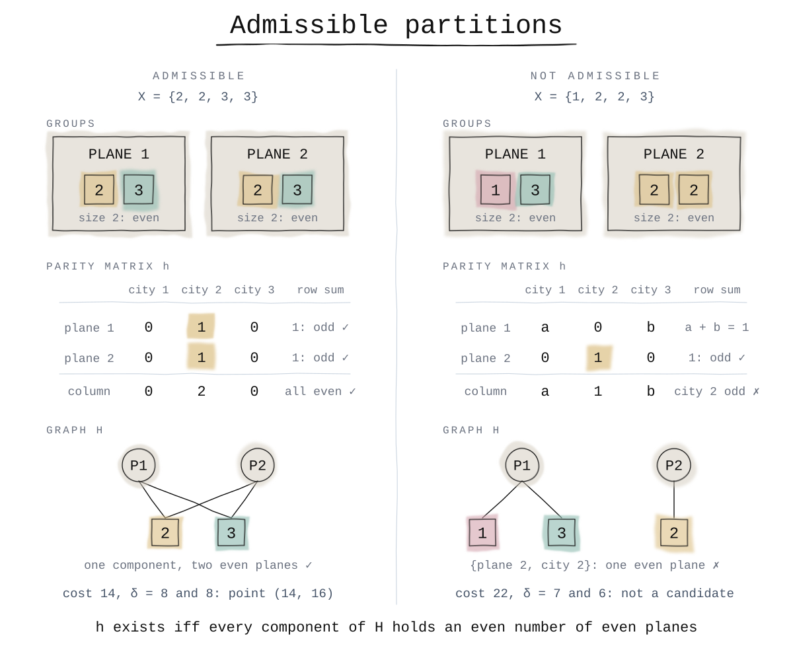
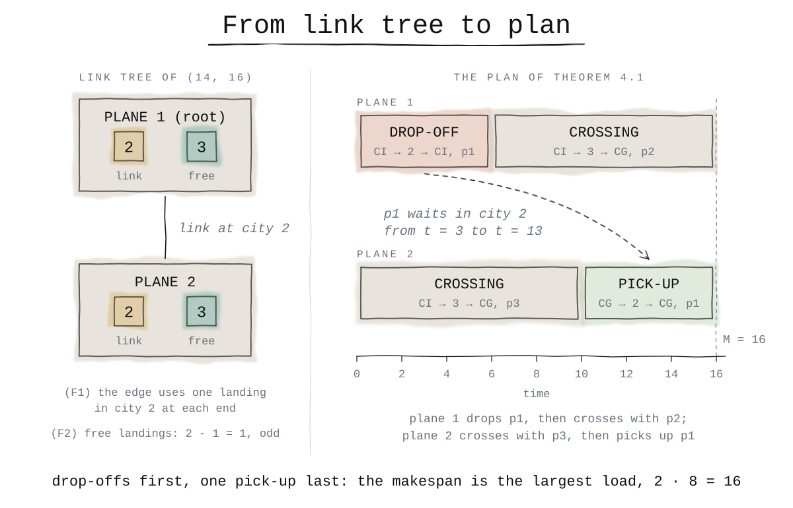
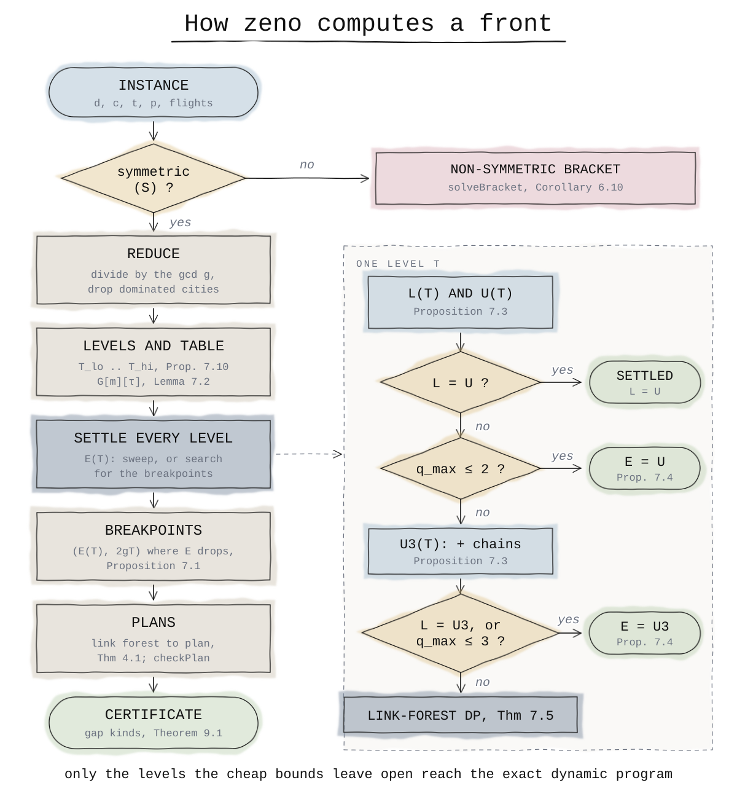

This page explains how `zeno` computes the Pareto front of a MultiZenoTravel instance, and why the
front it prints is exact. It can be read on its own: every symbol is defined here, and every claim
cites the result that proves it. A citation links to the entry of the [blueprint](../proofs.qmd)
that states and proves the result; the badge after it says how much of it Lean checks
(*machine-checked*, *parts in Lean*, *Lean definition*, or *informal* when the proof is on paper
only). The proofs themselves are in the
[theory note](https://github.com/aquemy/ZenoSolver/blob/master/doc/theory/exact-front.md). For
context, see the [problem page](../problem.qmd), which introduces the same example, and the
[paper section](../paper/index.qmd#sec-algorithm).

The page follows one instance from start to finish. Every number quoted for it, and every value
in the figures, is recomputed from the definitions by `site/gen_algorithm.py` and checked against
`zeno` ([how](#reproduce)).

## The setting {#setting}

**Instances and plans.** An instance has two hubs, $C_I$, where every plane and passenger starts,
and $C_G$, where they must all end, and $n$ central cities $1, \dots, n$
. Durations and costs are natural numbers. A flight between $C_I$ and
city $i$ lasts $d_i$ in either direction, a flight between city $i$ and $C_G$ lasts $\bar d_i$, and
no flight joins the two hubs. Every ordered pair of central cities $(i, j)$ is also joined by a
central flight, of duration $d_c(i, j)$. Landing in city $i$ costs $c_i$; landing in a hub is free.
There are $p$ planes and $t \ge p$ passengers, and a plane carries at most one passenger at a
time. A plan gives every plane a timed route from $C_I$ to $C_G$, and the flights that carry a
passenger form a timed route of their own from $C_I$ to $C_G$. Its *cost* is the sum of its
landing costs, and its *makespan* is the time at which the last plane reaches $C_G$
.

**The front.** A point $(C, M)$ *weakly dominates* $(C', M')$ if $C \le C'$ and $M \le M'$. The
Pareto front $\mathcal F$ is the set of (cost, makespan) points of feasible plans that no other
such point weakly dominates . `zeno` prints it as `cost makespan` lines.

**Assumptions** . Most of this page assumes

- (S), symmetry: $d_i = \bar d_i$ for every city, so a flight between city $i$ and either hub
  lasts $d_i$;
- and (H), the hub triangles: $d_j \le d_i + d_c(i, j)$ and $d_i \le d_c(i, j) + d_j$ for all
  central $i, j$, the triangle inequality on the triangles through a hub. It follows from (A1),
  every central flight from $i$ to $j$ lasts at least $d_i + d_j$, so it is never faster than going
  through a hub, and from (AΔ), the flight durations satisfy the triangle inequality
  .

Instances with $d \ne \bar d$ have their own pipeline, described [at the end](#nonsymmetric).

### Notation {#notation}

::: {.alg-notation}

| Symbol | Meaning |
|---|---|
| $s = 2t - p$ | the least number of segments, and of landings in central cities, of a feasible plan ([step 1](#reduction)) |
| $\kappa = \lceil s/p \rceil$ | the size of the largest group when $s$ landings are spread over $p$ planes as evenly as possible |
| $X$ | a multiset of central cities: the landings. $X(i)$ is the multiplicity of city $i$, $\lvert X \rvert$ the size |
| $c(X)$, $\delta(X)$ | $\sum_{i \in X} c_i$ and $\sum_{i \in X} d_i$, counted with multiplicity |
| $\ell(X) = 2\delta(X)$ | the *load*: the flight time of a plane that serves each landing of $X$ by its own round trip from a hub |
| $X_1, \dots, X_p$ | a *partition* of $X$: one group per plane, with $X_1 + \dots + X_p = X$ |
| even plane | a plane whose group has an even number of landings |
| $g$ | the gcd of the durations; `zeno` divides the durations by it |
| $T$ | a *level*: an integer bound on every $\delta(X_k)$, hence $2T$ on every load |
| $E(T)$ | the least cost of an admissible partition within level $T$ ([step 4](#levels)) |
| $L(T)$, $U(T)$ | a lower bound and an upper bound on $E(T)$ ([step 7](#bracket)) |
| $G[m][\tau]$ | the least cost of $m$ landings whose durations sum to at most $\tau$ ([step 6](#one-plane)) |
| $\hat m = s - p + 1$ | the largest group that can occur, every group being non-empty |
| $w = \min(p - 1,\ t - p)$ | the most cities a parity matrix needs to touch ([step 9](#sigma-dp)) |
| $T_{\rm lo}$, $T_{\rm hi}$ | the first level at which $E$ can be finite, and the level at which `zeno` stops ([step 4](#levels)) |

:::

$s$, $\kappa$, $c$, $\delta$ and $\ell$ are the notation of the theory note .

### The worked example {#example}

The instance of the [problem page](../problem.qmd)
([`site/problem/example.dat`](https://github.com/aquemy/ZenoSolver/blob/master/site/problem/example.dat))
has $n = 3$ cities, $t = 3$ passengers and $p = 2$ planes:

| city $i$ | 1 | 2 | 3 |
|---|---:|---:|---:|
| duration $d_i = \bar d_i$ | 2 | 3 | 5 |
| landing cost $c_i$ | 9 | 6 | 1 |

City 1 is fast and expensive, city 3 slow and cheap. So $s = 2 \cdot 3 - 2 = 4$ landings,
$\kappa = 2$ and $g = 1$. Its front, as `zeno -n 3 -t 3 -p 2 -d site/problem/example.dat` prints it,
and as the verified solver `zeno-front` computes it, is the same for every table of central flights
([step 12](#certificates)):

| makespan | 8 | 10 | 12 | 14 | 16 | 20 |
|---|---:|---:|---:|---:|---:|---:|
| cost | 36 | 30 | 24 | 20 | 14 | 4 |

The rest of the page derives this list. Part one says what is computed; part two says how.

## What is computed {#what}

### Step 1. From plans to landing multisets {#reduction}

**Idea.** A plan is a timed object, with routes, journeys and waiting, but its point on the front
depends on two numbers only. The first step replaces plans by a finite, untimed object: the
multiset of central cities the planes land in, split among the planes. Under (S), a landing in
city $i$ served by its own round trip from a hub ($C_I \to i \to C_G$, $C_G \to i \to C_I$,
$C_I \to i \to C_I$ or $C_G \to i \to C_G$) takes exactly $2d_i$ . If
every landing is flown this way, plane $k$ flies for $\ell(X_k) = 2\delta(X_k)$, and the question
becomes which landings to make and how to split them.

**Results.**

1. *Counting.* Every feasible plan has at least $s = 2t - p$ segments
   , and costs at least $s\,c_{\min}$ .
   Every passenger needs a flight out of $C_I$ and a flight into $C_G$. Cut each route at its
   visits to the hubs: each piece, a *segment*, lands in a central city, and along a route the
   flights out of $C_I$ and into $C_G$ number one more than the segments. Counting them gives
   $2t \le$ (segments) $+ p$.
2. *Achievability.* For every table of central flights, every multiset $X$ with $|X| = s$ and
   every *admissible* partition $X_1, \dots, X_p$ of it ([step 2](#admissible)), there is a
   feasible plan whose planes land exactly at the groups, hence of cost $c(X)$, and whose makespan
   is $\max_k \ell(X_k)$ . [Step 11](#plans) shows the construction.
3. *Converse.* Under (S) and (H), every feasible plan with cost $C$ and makespan $M$ is matched by
   an admissible partition of some $X$ with $|X| = s$, $c(X) \le C$ and $\ell(X_k) \le M$ for
   every plane .
4. *Together.* Let $M(X)$ be the least $\max_k \ell(X_k)$ over the admissible partitions of $X$.
   Under (S) and (H),
   $$\mathcal F = \mathrm{Min}\,\mathcal X, \qquad \mathcal X = \{(c(X), M(X)) : |X| = s,\ X \text{ has an admissible partition}\},$$
   where $\mathrm{Min}$ keeps the points that no other point of the set weakly dominates
   ; with Theorem 4.1, every front point is attained by a plan with
   exactly $s$ central landings. Other plans may attain it with more landings
   .

Some condition on the central flights is needed: with fast central flights that violate (H), a
plan can beat every admissible partition .

**In the example.** $s = 4$. The multiset $\{3, 3, 3, 3\}$ split as $\{3, 3\} \mid \{3, 3\}$ costs
$4$, each plane has $\delta = 10$, and the makespan is $20$: the point $(4, 20)$. The multiset
$\{1, 1, 1, 1\}$ split as $\{1, 1\} \mid \{1, 1\}$ costs $36$ with makespan $8$: the point
$(36, 8)$. The four other points come from multisets in between.

**In the code.** `solveFront`
([`src/zeno/solve.cpp`](https://github.com/aquemy/ZenoSolver/blob/master/src/zeno/solve.cpp))
takes symmetric instances and sends the others to `solveBracket` ([below](#nonsymmetric)).
`checkFlights`
([`include/zeno/flights.hpp`](https://github.com/aquemy/ZenoSolver/blob/master/include/zeno/flights.hpp))
decides (A1), (AΔ) and (A1-NS) in exact integer arithmetic. With a central flight table that
satisfies neither (A1) nor (AΔ), `zeno` still prints achieved points but warns that the front may
not be exact.

### Step 2. Admissible partitions {#admissible}

**Idea.** Not every split of $X$ among the planes can be flown with loads $\ell(X_k)$. In the plans
of step 1, every landing is a round trip from a hub of one of four kinds: a *crossing*
$C_I \to i \to C_G$ carrying a passenger, or its empty return $C_G \to i \to C_I$; a *drop-off*
$C_I \to i \to C_I$, which leaves a passenger in city $i$; and a *pick-up* $C_G \to i \to C_G$,
which collects one there. A plane starts in $C_I$ and ends in $C_G$, so it flies an odd number of
crossings, counting both directions . Every drop-off in city $i$ is
matched by a pick-up in city $i$ . So a plane with an even number of
landings must take part in a hand-off, and hand-offs pair up city by city. The parity matrix
records this bookkeeping modulo 2: $h_{k,i} = 1$ marks a plane that takes part in an odd number of
hand-offs in city $i$.

**Definition** . A *parity matrix* for a partition
$X_1, \dots, X_p$ is a 0/1 matrix $h$ with one row per plane and one column per city such that

- (h1) $h_{k,i} = 1$ only if plane $k$ lands in city $i$, that is $X_k(i) \ge 1$;
- (h2) row $k$ has $|X_k| + 1$ ones modulo 2: an odd number for an even plane, an even number for
  an odd plane;
- (h3) every column has an even number of ones.

The partition is *admissible* if it has a parity matrix.

**Equivalent forms.**

- Counting with multiplicities changes nothing: integer entries $0 \le \tilde h_{k,i} \le X_k(i)$
  with the same two parity conditions exist iff a parity matrix does .
  This is the form a link forest produces ([step 3](#link-forests)).
- *Disjoint groups.* If no city lies in two groups, the partition is admissible iff every group
  has odd size . Odd groups are always admissible: the zero matrix is a
  parity matrix.
- Every row has at most $|X_k| - 1$ ones : each plane keeps at least one
  landing outside the hand-offs, an admissible partition has no empty group, and $|X| \equiv p$
  modulo 2.

**In the example** (@fig-admissible). The multiset $\{2, 2, 3, 3\}$ split as
$\{2, 3\} \mid \{2, 3\}$: both planes are even, so each row needs an odd number of ones, and
marking city 2 in both rows gives the column sums $0, 2, 0$. The split is admissible. It costs
$14$, both planes have $\delta = 8$, and the makespan is $16$: the front point $(14, 16)$. The
split $\{1, 3\} \mid \{2, 2\}$ of $\{1, 2, 2, 3\}$ is not: plane 2 is even and lands only in city
2, so its row must mark city 2; plane 1 is even and lands in cities 1 and 3, so its row marks
exactly one of them; column 2 then holds a single one. The two groups share no city and are even,
which Lemma 2.3 excludes at a glance. This split is not a candidate in Theorem 4.5, whatever its
cost (22) and loads.

::: {#fig-admissible}
::: {.alg-ink}
[{fig-alt="Two splits of four landings between two planes. Left, groups {2, 3} and {2, 3}: the parity matrix marks city 2 in both rows, every column is even, and the graph H is connected with two even planes. Right, groups {1, 3} and {2, 2}: column 2 is forced to hold a single one, and in H plane 2 and city 2 form a component with one even plane."}](../algorithm/fig-admissible.svg)
:::

An admissible and a non-admissible split for the worked example, with the parity matrix of
Definition 2.1 and the bipartite graph $H$ that joins plane $k$ to city $i$ when $X_k(i) \ge 1$.
Cities keep their colours in every diagram of this page. Click to open the full-size drawing.
:::

**In the code.** `zeno` never enumerates parity matrices. Its dynamic programs only build
partitions that carry a link forest ([step 3](#link-forests)), which are admissible by
construction. Admissibility is still decidable by enumerating $h$ on the supports of the groups
; `gen_algorithm.py` does so over every partition of the example to
check the figures of this page.

### Step 3. Link forests {#link-forests}

**Idea.** A parity matrix says which landings take part in hand-offs, not who hands off to whom. A
link forest says it. Draw an edge between planes $u$ and $v$, labelled with city $i$, for each
passenger that one of them drops off in city $i$ and the other picks up there. Each edge uses one
landing in $i$ of both planes. The other landings of a plane are its *free landings*, flown as
crossings.

**Definition** . A *link forest* for $X_1, \dots, X_p$ is a
forest $\Lambda$ of rooted trees on the planes whose edges carry city labels. The group of a plane
is its free landings, one landing in the label of each edge to a child, and one in the label of
the edge to its parent, so that

- (F1) the edges at a plane use distinct landings of its group: for every plane $u$ and city $i$,
  at most $X_u(i)$ edges at $u$ are labelled $i$;
- (F2) $r_u = |X_u| - \deg_\Lambda(u)$, the number of free landings of $u$, is odd.

**Result.** A partition is admissible iff it has a link forest . In one
direction, counting the edges of each label at each plane gives the integer form of Lemma 2.2. In
the other, the forest is built from a parity matrix with the fewest ones, which has no cycle, by
removing a plane marked in at most one city and hanging it back.

Forests matter for two reasons. They can be built tree by tree, from the leaves up, by dynamic
programming ([step 8](#forest-dp)). And the plan built from a forest has makespan
$\max_k \ell(X_k)$ ([step 11](#plans)).

**In the example** (@fig-link-tree). For the point $(14, 16)$, one edge labelled city 2 joins
plane 1 to plane 2. Each plane keeps one free landing, in city 3:
$r_u = 2 - 1 = 1$, which is odd. In the plan, plane 1 drops passenger 1 in city 2 and plane 2
collects it.

::: {#fig-link-tree}
::: {.alg-ink}
[{fig-alt="Left: a tree with plane 1 as root and plane 2 as its child, joined by an edge labelled city 2; each plane holds a landing in city 2 for the link and a free landing in city 3. Right: the plan on a time axis from 0 to 16. Plane 1 drops passenger 1 in city 2 from 0 to 6, then crosses through city 3 with passenger 2 until 16. Plane 2 crosses through city 3 with passenger 3 from 0 to 10, then picks up passenger 1 in city 2 from 10 to 16. Passenger 1 waits in city 2 from time 3 to time 13."}](../algorithm/fig-link-tree.svg)
:::

The link forest of the point $(14, 16)$ and the plan built from it. Left: the tree; its edge uses
one landing in city 2 of each plane (F1), and each plane keeps one free landing (F2). Right: the
plan of Theorem 4.1 on a time axis, as `zeno --plans` prints it ([step 11](#plans)).
:::

**In the code.** `LinkForest` and `ForestPlane`
([`include/zeno/forest.hpp`](https://github.com/aquemy/ZenoSolver/blob/master/include/zeno/forest.hpp))
store, for each plane, its *filler* (the odd number of free landings), its parent, and the label of
the edge to it. The group of a plane is its filler, plus its parent's label, plus one landing per
child edge.

### Step 4. The level function $E(T)$ and its breakpoints {#levels}

**Idea.** Theorem 4.5 still asks for the Pareto set of a search with two objectives. Turn it
into a family of searches with one: fix a budget $T$ for every plane, and ask for the cheapest
admissible way to fit in it. As the budget grows, the least cost can only drop, and each drop is a
front point.

**Definition.** For an integer level $T \ge 0$,
$$E(T) = \min\{c(X) : |X| = s,\ X_1, \dots, X_p \text{ admissible},\ \delta(X_k) \le T \text{ for every } k\},$$
with $\min \emptyset = \infty$. A larger $T$ allows more partitions, so $E$ is non-increasing.
`zeno` first divides the durations by their gcd $g$, so that its level $T$ stands for the
makespan $2gT$; in the example $g = 1$.

**Results.**

- Under (S) and (H), the front is the set of *breakpoints* of $E$
  : $(C, M) \in \mathcal F$ iff $M = 2T$ for a level $T$ with
  $E(T) = C$ and $E(T') > C$ for every $T' < T$.
- Only a bounded range of levels matters : $E$ is non-increasing,
  $E(T) = \infty$ for $T < T_{\rm lo} = d_{\min}\kappa$, with $d_{\min}$ the smallest duration, and
  every level at which $E$ drops is at most $(2t - p)\,d_{\max}$. Every plan has makespan at
  least $2d_{\min}\kappa$ and costs at least $s\,c_{\min}$, with $c_{\min}$ the smallest cost,
  whatever the central flights .
- `zeno` scans the levels from $T_{\rm lo}$ to $T_{\rm hi} = d_{\rm cheap}\kappa$, with
  $d_{\rm cheap}$ the smallest duration among the cities of cost $c_{\min}$, where it expects the
  cheapest cost $s\,c_{\min}$. The last obligation of its certificate, $C_r = s\,c_{\min}$, checks
  that the cheapest point it prints is the cheapest of all ([step 12](#certificates)).

**In the example** (@fig-staircase). $T_{\rm lo} = 2 \cdot 2 = 4$ and
$T_{\rm hi} = 5 \cdot 2 = 10$: seven levels. On $T = 4, \dots, 10$, $E$ takes the values 36, 30,
24, 20, 14, 14 and 4. It drops at every level but $T = 9$, where the cheapest groups within the
budget are still $\{2, 3\} \mid \{2, 3\}$: no plan of makespan 18 is cheaper than the plan of
makespan 16. Six breakpoints, six front points.

::: {#fig-staircase}
```{=html}
<div data-figure>
  <div class="alg-legend" aria-hidden="true">
    <span><i class="alg-key alg-key-line"></i>E(T)</span>
    <span><i class="alg-key alg-key-dot"></i>breakpoint: front point (E(T), 2gT)</span>
    <span><i class="alg-key alg-key-hollow"></i>no drop: no new point</span>
  </div>
  <div id="alg-staircase" class="alg-plot"></div>
</div>
```

$E(T)$ for the worked example. Each filled dot is a breakpoint, labelled with its front point;
the hollow dot at $T = 9$ is a level where $E$ does not drop. Below $T_{\rm lo}$ no partition
fits; at $T_{\rm hi}$, $E$ reaches the cheapest cost $s\,c_{\min} = 4$. Hover over a level, or
focus it with the keyboard, for its cheapest admissible groups.
:::

<details>
<summary>Table view: the levels of the worked example</summary>



</details>

**In the code.** `ReducedInstance::lowestLevel()` and `highestLevel()`
([`include/zeno/reduce.hpp`](https://github.com/aquemy/ZenoSolver/blob/master/include/zeno/reduce.hpp))
give $T_{\rm lo}$ and $T_{\rm hi}$, and `makespanPerLevel` is $2g$. Once every level is settled,
`extract()` in `solve.cpp` emits a front point wherever $E$ drops, and checks that $E$ never
rises.

## How zeno computes it {#how}

@fig-pipeline is the map of the symmetric solver, `solveFront`. The left column runs once per
instance. The panel on the right settles one level: it tries the cheap bounds first, and the exact
program only when they disagree.

::: {#fig-pipeline}
::: {.alg-ink}
[{fig-alt="Flowchart. Instance; if not symmetric, the non-symmetric bracket. Otherwise: reduce (gcd, dominated cities), levels and one-plane table, settle every level, breakpoints, plans, certificate. Settling one level: compute L and U; if L equals U the level is settled; else if q_max is at most 2, zeno takes U as E; else compute U3; if L equals U3 or q_max is at most 3, zeno takes U3 as E; else run the link-forest DP."}](../algorithm/fig-pipeline.svg)
:::

The orchestration of `solveFront`
([`src/zeno/solve.cpp`](https://github.com/aquemy/ZenoSolver/blob/master/src/zeno/solve.cpp)).
The branch that settles a level is what `zeno --stats` counts: `bracket`, `pairs`, `chains`,
`exact`, and `monotone` for the levels that bisection settles ([step 8](#forest-dp)). The
branches `bracket`, `exact` and `monotone` rest on Proposition 6.4, Theorem 6.7 and Lemma 6.2;
`pairs` and `chains`, where
$q_{\max} = \min(p, t - p + 1)$ is the largest link tree `zeno` builds, are optimisations of the
C++ solver that this page does not prove, and the certificate of the run checks the front they
give.
:::

### Step 5. Reduce the instance {#reduce}

**Idea.** A city that is no faster and no cheaper than another is never needed: replacing each of
its landings by a landing in the other city keeps the partition admissible (merge the two columns
of the parity matrix) and raises neither the cost nor a load.

**Result** . For every map $\mathrm{rep}$ from cities to cities with
$d_{\mathrm{rep}(i)} \le d_i$ and $c_{\mathrm{rep}(i)} \le c_i$, replacing every landing of an
admissible partition by its image gives an admissible partition with the same group sizes and no
larger cost or loads. `zeno` keeps one city per class of equal $(d, c)$ and drops the dominated
ones; the cities that remain form a *staircase*: durations strictly increasing, costs strictly
decreasing.

**In the example.** $2 < 3 < 5$ and $9 > 6 > 1$: the cities already form a staircase, and $g = 1$.
Nothing changes.

**In the code.** `reduce`
([`src/zeno/reduce.cpp`](https://github.com/aquemy/ZenoSolver/blob/master/src/zeno/reduce.cpp))
merges equal cities, drops dominated ones, divides the durations by $g$, and computes the level
range. `zeno --stats` prints the result, here `levels 4..10 (x1, 7 levels), cities 3, max tree 2`.

### Step 6. The one-plane table {#one-plane}

**Idea.** Every bound and every exact method below keeps asking one question: what is the
cheapest way for a single plane to make $m$ landings within a budget $\tau$? It is a knapsack with
exactly $m$ items, in which each city can be used any number of times, and one table answers it
for all $m$ and $\tau$ at once.

**Result** . Let $G[0][\tau] = 0$ and
$$G[m][\tau] = \min_{i:\ d_i \le \tau} \big(c_i + G[m-1][\tau - d_i]\big),$$
$\infty$ over the empty set. Then $G[m][\tau]$ is the least cost of a multiset of $m$ cities whose
durations sum to at most $\tau$, and it is $\infty$ iff there is none.

**In the example** (@fig-table). $m$ runs up to $\hat m = 3$ and $\tau$ up to $T_{\rm hi} = 10$.
For instance $G[2][8] = 7$: one landing in city 2 and one in city 3, of durations
$3 + 5 = 8$. Replay the fill to see each cell computed from a cell of the row above.

::: {#fig-table}
```{=html}
<div data-figure>
  <div class="alg-controls" id="alg-table-controls">
    <button type="button">Fill the table step by step</button>
  </div>
  <div class="alg-legend" aria-hidden="true">
    <span><i class="alg-key alg-key-hollow"></i>the cell computed</span>
    <span><i class="alg-key alg-key-hollow" style="border-color: var(--zs-series-2)"></i>the cell of row m − 1 it extends</span>
    <span><i class="alg-key alg-key-dot"></i>staircase point: G[m][·] drops</span>
  </div>
  <div id="alg-table"></div>
</div>
```

The one-plane table $G[m][\tau]$ of the worked example: rows $m$, columns $\tau$. Hover over a
cell, or focus it, to see the cell of row $m - 1$ it extends (orange outline) and a cheapest group.
A dot marks the cells where $G[m][\cdot]$ drops, the only cells the staircase layout stores.
:::

<details>
<summary>Table view: $G[m][\tau]$</summary>



</details>

**In the code.** `OnePlaneTable`
([`include/zeno/one_plane.hpp`](https://github.com/aquemy/ZenoSolver/blob/master/include/zeno/one_plane.hpp))
has two layouts. The dense one stores every cell; `zeno` uses it up to $2^{22}$ cells. Beyond, it stores for each $m$ only the Pareto points
(load, cost) where $G[m][\cdot]$ drops, the dotted cells of the figure, so that memory does not
depend on the magnitude of the durations; a lookup is then a binary search.

### Step 7. The bracket {#bracket}

**Idea.** Before solving a level exactly, sandwich $E(T)$ between a cheap lower bound and a cheap
upper bound, $L \le E \le U$. Both are knapsacks that combine small *gadgets* (a few planes with
their groups) filled with $G$-optimal landings. Where the lower bound meets the upper bound, the
level is settled.

**The bounds.** A knapsack over planes and landings combines gadgets, with
$\mathrm{For}[0][0] = 0$ and
$$\mathrm{For}[P][J] = \min\big(\mathrm{For}[P - q][J - j] + \text{cost}\big)$$
over the gadgets of $q$ planes, $j$ landings and that cost; the bound is $\mathrm{For}[p][s]$.

- $L(T)$: one plane with any number $m \in [1, \hat m]$ of landings, at cost $G[m][T]$.
  Admissibility is ignored, so this is a relaxation. It bounds more than $E$: under (S) alone,
  whatever the central flights, every feasible plan of makespan $M$ costs at least
  $L(\lfloor M/2 \rfloor)$ .
- $U(T)$: one plane with an odd number $m$ of landings, at cost $G[m][T]$; or a *pair*: two planes
  of even sizes $a$ and $b$ linked at a non-dominated city $i$, at cost
  $$2c_i + G[a-1][T - d_i] + G[b-1][T - d_i].$$

**Result.** $L(T) \le E(T) \le U(T)$, and where $L(T) = U(T)$, $E(T) = L(T)$
. Each gadget of $U$ is a link tree with one or two planes that
satisfies (F1) and (F2), so its groups are admissible by Lemma 2.6.

**In the example** (@fig-bracket). $L = U$ at every level: all seven levels are closed by the
bracket, and `zeno --stats` reports `settled: bracket 7, pairs 0, chains 0, monotone 0, exact 0`.

The *contrast instance* of the figure shows what an open level looks like: three cities with
$d = (3, 5, 7)$ and $c = (10, 5, 1)$, $t = 4$ passengers and $p = 2$ planes
([`contrast.dat`](../algorithm/contrast.dat)), so $s = 6$ and the levels run from 9 to 21. At
$T = 12$, the cheapest relaxed split is $\{2, 3\} \mid \{1, 1, 1, 1\}$, of cost 46: two even
planes that share no city, so the split is not admissible (Lemma 2.3). The cheapest admissible
split, $\{1, 1, 2\} \mid \{1, 1, 2\}$, costs $50 = U(12)$. Levels 12 and 14 stay open, and
`zeno --stats` reports `settled: bracket 11, pairs 2`: `zeno` takes $U$ as exact there, since
$p = 2$, and the certificate checks both levels with the exact program ([step 12](#certificates)).

::: {#fig-bracket}
```{=html}
<div data-figure>
  <div class="alg-controls" role="group" aria-label="Instance">
    <button type="button" data-instance="example" aria-pressed="true">Worked example</button>
    <button type="button" data-instance="contrast" aria-pressed="false">Contrast instance</button>
  </div>
  <div class="alg-legend" aria-hidden="true">
    <span><i class="alg-key alg-key-L"></i>L(T), relaxation</span>
    <span><i class="alg-key alg-key-U"></i>U(T), pairs bound</span>
    <span><i class="alg-key alg-key-dot"></i>E(T)</span>
    <span><i class="alg-key alg-key-band"></i>open level: L &lt; U</span>
  </div>
  <div id="alg-bracket" class="alg-plot"></div>
  <p class="alg-status"><span data-note></span> <code data-stats></code></p>
</div>
```

The bracket per level. For each level $T$, the aqua tick is $L(T)$, the orange tick $U(T)$ and
the blue dot $E(T)$. On a closed level the three coincide; a shaded level is open. Switch between
the worked example, where every level closes, and the contrast instance, where two levels stay
open. Hover over a level for the groups behind each value.
:::

<details>
<summary>Table view: the levels of the contrast instance</summary>



</details>

**In the code.** `relaxedCost` computes $L$, and `forestCost(r, G, T, q)` runs the link-forest
program of [step 8](#forest-dp) restricted to trees of at most $q$ planes
([`src/zeno/forest.cpp`](https://github.com/aquemy/ZenoSolver/blob/master/src/zeno/forest.cpp)):
with $q = 2$ it ranges over the same trees as the gadgets of $U$, and with $q = 3$ it gives a
chains bound $U_3$ over trees of up to three planes. In sweep mode, `bracket()` computes $L$ and
$U$ on every level in parallel, and `chains()` adds $U_3$ on the levels left open when
$q_{\max} = \min(p, t - p + 1)$, the largest tree `zeno` builds, is at least 3. Taking $U$ or $U_3$
as exact for small $q_{\max}$ is an optimisation of the C++ solver, not a result of this page; the
certificate of the run checks the front. Every value is checked to lie inside its bracket.

### Step 8. The link-forest DP {#forest-dp}

**Idea.** When the bracket leaves a level open, `zeno` computes $E(T)$ exactly. By Lemma 2.6,
$E(T)$ is the least cost of $p$ groups with $s$ landings in all, each within $T$, that carry a
link forest. Root every tree at a plane. The group of a plane is then its free landings (an odd number $r$), plus one landing
per child edge, plus one for the edge to its parent. The program builds such trees from the leaves
up, attaching to each plane the subtrees that hang from it.

**Tables**, for one level $T$:

- $\mathrm{Ch}_q[\tau][j]$: the least cost of a multiset of *child items*. An item is a link label
  $b$, with one landing in $b$ in the parent's group, and the subtree hanging from that link. The
  labels' durations sum to $\tau$, the subtrees have $q$ planes in all, and $j$ counts the
  landings;
- $\mathrm{Sub}_a[q][j]$: the least cost of a subtree with $q$ planes and $j$ landings whose root
  holds one landing in $a$ for the link to its parent;
- $\mathrm{Root}[q][j]$: the least cost of a tree with $q$ planes and $j$ landings;
- $\mathrm{For}[P][J]$: the least cost of a forest on $P$ planes with $J$ landings.

For $q = 1, \dots, p$ in order, with $r$ odd, $\tau \in [0, T]$ and the link labels $a$, $b$
among the non-dominated cities,
$$\mathrm{Sub}_a[q][j] = \min_{\tau,\ j' + 1 + r = j} \big(c_a + \mathrm{Ch}_{q-1}[\tau][j'] + G[r][T - d_a - \tau]\big),$$
$$\mathrm{Root}[q][j] = \min_{\tau,\ j' + r = j} \big(\mathrm{Ch}_{q-1}[\tau][j'] + G[r][T - \tau]\big),$$
$$\mathrm{Ch}_q[\tau][j] = \min_{b,\ 1 \le q' \le q,\ j'} \big(\mathrm{Ch}_{q-q'}[\tau - d_b][j - 1 - j'] + c_b + \mathrm{Sub}_b[q'][j']\big),$$
with $\mathrm{Ch}_0[0][0] = 0$, and finally, with $\mathrm{For}[0][0] = 0$,
$$\mathrm{For}[P][J] = \min_{1 \le q \le P,\ j} \big(\mathrm{For}[P - q][J - j] + \mathrm{Root}[q][j]\big).$$

**Result** . $\mathrm{For}[p][s] = E(T)$ when $1 \le p$. With a step
counter, the program takes at most $30\,(n + 1)^2(p + 1)^2(t + 1)^2(T + 1)$ steps per level
. `zeno` caps the trees at $q_{\max}$ planes, an optimisation that the
certificate of the run checks.

**In the example**, at $T = 8$. With $p = 2$, a tree is a single plane or a pair.

- A single plane with one or three landings: $\mathrm{Root}[1][1] = G[1][8] = 1$ and
  $\mathrm{Root}[1][3] = G[3][8] = 21$.
- A leaf hanging from a link at city 2, with one free landing within $8 - d_2 = 5$:
  $\mathrm{Sub}_2[1][2] = c_2 + G[1][5] = 7$.
- The parent's side of that link: $\mathrm{Ch}_1[3][3] = c_2 + \mathrm{Sub}_2[1][2] = 13$.
- The pair, rooted at a plane with one free landing within $8 - 3 = 5$:
  $$\mathrm{Root}[2][4] = \mathrm{Ch}_1[3][3] + G[1][5] = 13 + 1 = 14.$$
- The forest, a pair or two single planes:
  $$\mathrm{For}[2][4] = \min\big(\mathrm{Root}[2][4],\ \mathrm{Root}[1][1] + \mathrm{Root}[1][3]\big) = \min(14, 22) = 14 = E(8).$$

The pair is the tree of @fig-link-tree. A link at city 3 with free landings in city 2 gives the
same groups and the same cost.

**In the code.** `ForestProgram`
([`include/zeno/forest.hpp`](https://github.com/aquemy/ZenoSolver/blob/master/include/zeno/forest.hpp),
[`src/zeno/forest.cpp`](https://github.com/aquemy/ZenoSolver/blob/master/src/zeno/forest.cpp)).
Instead of dense arrays over $\tau$, it keeps the child items of a plane as Pareto staircases over
$(\tau, \text{cost})$, so its work depends on the sizes of these staircases, not on the magnitude
of $T$. `reconstruct()` returns an optimal `LinkForest`, which [step 11](#plans) turns into a plan.
In sweep mode the exact program runs only where the bracket and monotonicity leave a level open.
Since $E$ is non-increasing, a level between two settled levels $a < b$ has
$E(b) \le E \le E(a)$, which tightens its bracket, and equal values at both ends settle every level
between them (`monotone` in `--stats`). `bisect()` evaluates up to `threads` evenly spaced open
levels exactly, and recurses on the pieces.

### Step 9. The σ-DP {#sigma-dp}

**Idea.** A second exact method works with parity matrices directly. Process the planes one at a
time, choosing for each its number of landings and its row of the parity matrix, and remember only
the set $\sigma$ of cities whose column has an odd number of ones so far. At the end, $\sigma$ must
be empty, which is (h3). Some parity matrix touches few cities, so $\sigma$ stays small.

**Results.**

- For an admissible partition with $|X| = s$, some parity matrix touches at most
  $w = \min(p - 1, t - p)$ cities , and every row of a parity matrix has at
  most $|X_k| - 1$ ones .
- The *σ-graph* at level $T$ has nodes $(k, j, \sigma)$: $k$ planes processed, $j$ landings used,
  and $\sigma$ a set of at most $w$ non-dominated cities. An arc gives plane $k + 1$ a size $m$ and
  a row $\eta$, a set of at most $w$ non-dominated cities, with $|\eta| \equiv m + 1 \pmod 2$,
  $|\eta| + 1 \le m$, $\delta(\eta) \le T$ and $|\sigma \triangle \eta| \le w$; it leads to
  $(k + 1, j + m, \sigma \triangle \eta)$ and weighs $c(\eta) + G[m - |\eta|][T - \delta(\eta)]$.
  With $1 \le p \le t$, the shortest path from $(0, 0, \emptyset)$ to $(p, s, \emptyset)$ weighs
  $E(T)$ .

**In the example**, $w = 1$. At $T = 8$, plane 1 takes $m = 2$ landings with the row
$\eta = \{2\}$: an arc of weight $c_2 + G[1][8 - 3] = 7$ from $(0, 0, \emptyset)$ to
$(1, 2, \{2\})$. Plane 2 takes the same option, $\sigma$ becomes
$\{2\} \triangle \{2\} = \emptyset$, and the path ends at $(2, 4, \emptyset)$ with weight
$14 = E(8)$.

**In the code.** The C++ solver uses the link-forest DP. The σ-DP belongs to the Lean tools:
 and the Lean checker compute
$E$ with it, or with the link-forest DP when `useTreeDP` estimates that cheaper
([Lean tools](lean.qmd)).

### Step 10. Finding the breakpoints {#breakpoints}

**Idea.** Proposition 6.3 needs $E$ only where it drops. Since $E$ is non-increasing
(Lemma 6.2), an interval of levels whose two ends have equal values is constant and holds no
breakpoint, so a search can skip it whole. The verified solver searches the same way, and its proof
shows that splitting intervals finds the same points as scanning every level
.

**The search** `breakpoints`
([`include/zeno/breakpoints.hpp`](https://github.com/aquemy/ZenoSolver/blob/master/include/zeno/breakpoints.hpp)).
It starts from $E(T_{\rm lo})$ and from $E(T_{\rm hi})$, which `zeno` takes to be $s\,c_{\min}$.
Every open interval $(a, b)$ with $E(a) > E(b)$ is split at up to `threads` evenly spaced levels,
evaluated in parallel; pieces with equal ends are dropped, and a piece $(a, a + 1)$ has its
breakpoint at $a + 1$. Each level is evaluated by the cascade of @fig-pipeline: $L$ and $U$, then
$U_3$, then the exact program, each only if the previous ones do not settle it.

`--levels sweep` brackets every level and runs the exact program only where needed
([step 8](#forest-dp)); `--levels search` runs the search above; the default, `auto`, sweeps up to
$2^{12}$ levels and searches beyond.

**In the example.** Seven levels: `auto` sweeps them. With `--levels search --threads 1`, `zeno`
evaluates $T = 4$, then $7$, then $5$ and $8$, then $6$ and $9$; $T = 10$ is $T_{\rm hi}$. On so
few levels the search saves nothing. It pays off on ranges of thousands of levels with few
breakpoints.

### Step 11. Plans {#plans}

**Construction** . Take a link forest of the partition and root each
tree. Every plane flies, in this order:

1. its *drop-offs*, $C_I \to b \to C_I$, one per child edge labelled $b$, each leaving a new
   passenger in city $b$, from time 0;
2. its free landings as alternating crossings: $C_I \to x \to C_G$ carrying a new passenger, then
   $C_G \to x \to C_I$ empty, and so on, ending in $C_G$; there is an odd number of them by (F2);
3. if it has a parent edge labelled $a$, its *pick-up* $C_G \to a \to C_G$, leaving city $a$ once
   the passenger its parent dropped there has arrived.

No drop-off and no crossing ever waits. A plane picks up at most once, from its parent, whose
drop-offs come first; the timing argument of the theorem shows that each pick-up ends by the
larger load of the two planes. So every plane flies exactly $\ell(X_k)$ and the makespan is
$\max_k \ell(X_k)$. A forest with $N$ edges hands off $N$ passengers, and the crossings carry the
other $t - N$.

**In the example.** The plan of $(14, 16)$, as `zeno --plans` prints it; a leg reads
`from->to[depart,arrive]`, followed by the passenger it carries:

```text
plane 1: CI->c2[0,3]p1 c2->CI[3,6] CI->c3[6,11]p2 c3->CG[11,16]p2
plane 2: CI->c3[0,5]p3 c3->CG[5,10]p3 CG->c2[10,13] c2->CG[13,16]p1
```

Plane 1 is the root: it drops passenger 1 in city 2 and returns, then crosses through city 3 with
passenger 2. Plane 2 crosses through city 3 with passenger 3, flies empty from $C_G$ to city 2,
and brings back passenger 1, who has waited there since time 3. Both planes finish at
$16 = 2 \cdot 8$ (@fig-link-tree).

<details>
<summary>The full output of `zeno --plans --stats` for the worked example</summary>



</details>

**In the code.** For each front point, `FrontSolver::plans` (`solve.cpp`) takes the level
$T = M/2g$, reruns `ForestProgram` with trees of at most 2, then 3, then $q_{\max}$ planes, and
keeps the first whose value equals the point's cost. `reconstruct()` gives its link forest, and
`buildPlan`
([`include/zeno/plan.hpp`](https://github.com/aquemy/ZenoSolver/blob/master/include/zeno/plan.hpp))
the plan of Theorem 4.1. `checkPlan` then re-simulates every plan against the model, sharing no
code with `buildPlan`; a plan whose cost or makespan differs from its point stops the solver.

### Step 12. Certificates {#certificates}

**Idea.** A front can be checked without trusting the solver that found it. A certificate lists
the points, a plan for each, and, for each gap between consecutive points, the name of a lower
bound that the checker recomputes.

**Result** . Let $(C_1, M_1), \dots, (C_r, M_r)$ have increasing
makespans and decreasing costs. The list is the front if

1. every listed plan is feasible, with cost $C_i$ and makespan $M_i$: the checker simulates it;
2. no plan is faster than $M_1$: the checker verifies $M_1 = 2d_{\min}\kappa$
   ;
3. for every $i < r$, every plan of makespan below $M_{i+1}$ costs at least $C_i$: a lower bound
   at the level $T^\star_i = \lfloor \lfloor (M_{i+1} - 1)/2 \rfloor / g \rfloor$ reaches $C_i$
   (for a front point, $T^\star_i = T_{i+1} - 1$);
4. no plan is cheaper than $C_r$: the checker verifies $C_r = s\,c_{\min}$, since every plan
   costs at least $s\,c_{\min}$ .

Obligation 3 names one of two bounds:

- `relaxed`: $L(T^\star_i) \ge C_i$. Sound under (S) alone, whatever the central flights
  ;
- `forest`: $E(T^\star_i) \ge C_i$, recomputed with the link-forest DP or the σ-DP. Sound under
  (S) and (H) .

If the Lean checker accepts a certificate, its points are the front for every table of central
flights satisfying (H), and for every table if all its gaps are `relaxed`
. `zeno` writes `relaxed` whenever $L$ reaches the cost.

**In the example.** All five gaps are `relaxed`:



The contrast instance needs `forest` exactly at its two open levels, $T^\star = 12$ and $14$:



**In the code.** `makeCertificate` and `symmetricGaps`
([`include/zeno/certificate.hpp`](https://github.com/aquemy/ZenoSolver/blob/master/include/zeno/certificate.hpp)).
`zeno check FILE` is the reference checker; the Lean checker `zeno-check` is proved sound
([Lean tools](lean.qmd)). The file format is on the [certificates](certificates.qmd) page.

## Non-symmetric instances {#nonsymmetric}

When $d \ne \bar d$, the duration of a landing depends on how it is flown, and step 1 no longer
gives the front. `zeno` then computes a *certified bracket* instead (`solveBracket`,
[`include/zeno/ns.hpp`](https://github.com/aquemy/ZenoSolver/blob/master/include/zeno/ns.hpp)).

**Roles.** A landing in city $i$ is flown as a *crossing* $C_I \to i \to C_G$ or back, which lasts
$d_i + \bar d_i$; as a *drop-off* $C_I \to i \to C_I$, which lasts $2d_i$; or as a *pick-up*
$C_G \to i \to C_G$, which lasts $2\bar d_i$. A *role configuration* gives every plane its
drop-offs, pick-ups and crossings, with an odd number of crossings per plane and, city by city, as
many drop-offs as pick-ups. The *role load* $\lambda_k$ of plane $k$ sums the durations of its
roles . A *scheduled configuration* also orders the drop-offs and the
pick-ups of every plane and matches every pick-up to a drop-off in its city; its *template value*
$M_{\rm tmpl}$ is the larger of the largest role load and of the longest chain from a drop-off,
through its passenger, to the end of the matched pick-up plane .

**What carries over, and what does not.**

- Under (A1-NS), central flights at least as long as $\min(d_i + d_j,\ \bar d_i + \bar d_j)$,
  every plan with cost $C$ and makespan $M$ gives a role configuration with $2t - p$ landings,
  cost at most $C$, and role loads at most $M$ . So the least cost of
  a role configuration within a load bound is a lower bound.
- A configuration need not fly within its largest role load: a pick-up can reach a city before the
  passenger it collects has been dropped there, and wait. That waiting can be harmful. On an
  instance with two cities, the cheapest role configuration with loads at most 73 costs 14, while
  no plan of makespan at most 73 costs less than 18 . Role loads
  alone do not give the front.
- The *template* of a valid scheduled configuration (drop-offs first, then crossings, then
  pick-ups, each waiting for its passenger) is a feasible plan of makespan exactly $M_{\rm tmpl}$,
  whatever the central flights .
- Under (A1-NS), every plan is weakly dominated by a valid scheduled configuration whose template
  finishes no later . Hence the front is the Pareto set of (cost, least
  template value) over role configurations .

**The bracket.**

1. *Upper points.* Plans built from link forests in which every plane picks up at most once, or,
   by time reversal, drops off at most once, and from the cheapest balanced role configurations
   found inside gaps. All are scheduled and simulated with their waiting, so every printed point is
   a real plan.
2. *Lower bounds per gap*, for every plan of makespan below the next point:
   - `relaxed`: the relaxation of  with each landing
     weighted $\min(2d_i, 2\bar d_i)$, which needs no assumption on central flights;
   - `roles`: the role relaxation, in which each plane flies an odd number of crossings and the
     loads add up to the crossing weight of the landings , under
     (A1-NS) through Corollary 5.4;
   - `lagrangian`: a Lagrangian relaxation of the per-city balance, with one multiplier per city
     , under (A1-NS);
   - `balanced`: a program over balanced role configurations, a shortest path over the planes on
     the vector of per-city imbalances , under (A1-NS). It stops at
     the `roleStates` and `roleWork` limits;
   - `search`: the exhaustive search over the scheduled configurations cheaper than the gap's
     cost, each with every drop-off order and matching, the closed form of Definition 5.2 giving
     its template value . It rests on Theorem 5.3, stops at
     `searchWork`, and is the kind that closes the gap of Proposition 5.7, opened by harmful
     waiting.

   If the Lean checker accepts a certificate of version 2, its points are the front for every table
   of central flights satisfying (A1-NS) when the certificate lists that assumption
   .
3. *Report.* The front is exact when the fastest makespan is certified and every gap is closed.
   Otherwise `zeno` lists each open gap with its proved lower bound and the reason it stays open,
   rather than print a front it cannot prove ([command line](cli.qmd#front)). The refinement of
   open gaps stops after `refineSeconds`.

On 1,800 random tiny non-symmetric instances checked against a brute-force oracle, every bracket
closes and equals the oracle's front
([`README.md`](https://github.com/aquemy/ZenoSolver/blob/master/README.md)).

## Complexity {#complexity}

**Steps of the exact program** . At every level $T$, the link-forest DP
with a step counter returns its value in at most
$P(n, t, p, T) = 30\,(n + 1)^2(p + 1)^2(t + 1)^2(T + 1)$ steps. With $1 \le p \le t$, building $G$
once for the levels $0, \dots, T_{\rm top} = (2t - p)\,d_{\max}$ and running the counted DP at
each of them returns the front of the verified solver in at most
$(T_{\rm top} + 1)\,P(n, t, p, T_{\rm top})$ steps, the table included. A step is one iteration of
a minimum loop, one cell of a table, one element scanned by a membership test, or one level of
the scan. So $E(T)$ and the front take a number of steps polynomial in $n$, $t$, $p$ and
$(2t - p)\,d_{\max}$: pseudo-polynomial in the durations.

**How hard the problem is.**

- Deciding whether a *fixed* multiset $X$ has an admissible partition with every
  $\delta(X_k) \le T$, that is $M(X) \le 2T$, is as hard as 3-Partition: with $3m$ cities of
  durations $a_i$, $B/4 < a_i < B/2$ and $\sum_i a_i = mB$, $p = m$ and $t = 2m$, the multiset that
  lands once in every city has $M(X) \le 2B$ iff the $a_i$ split into $m$ triples of sum $B$
  . With two planes, the same holds for Partition
  .
- 3-Partition is strongly NP-complete and Partition NP-complete (Garey and Johnson, *Computers and
  Intractability*, 1979), and both reductions write their instances in polynomial time. Granted
  these cited results, deciding $M(X) \le 2T$ is strongly NP-hard when $p$ is part of the input,
  and NP-hard for $p = 2$. So, unless P = NP, a method that fixes the multiset first and then
  schedules it in polynomial time, for instance greedily with the longest landing first onto the
  least-loaded plane, cannot be exact in general. The greedies of both earlier papers do miss front
  points . The link-forest DP never fixes the multiset: it chooses
  the landings and their split together.

Theorem 7.3 counts the steps of the Lean program with dense tables. The C++ solver uses staircase
layouts and the breakpoint search; its measured scaling is on the [results](../results.qmd) and
[size guidance](../instances/sizing.qmd) pages.

## Reproducing this page {#reproduce}

With `build/release/zeno` built ([installation](install.qmd)), from the repository root:

```sh
python3 site/gen_algorithm.py
```

The script needs nothing else. For the worked example and the contrast instance, it recomputes
from their definitions the table $G$, and at every level $L$, $U$, $U_3$, and $E$ three ways: by
the link-forest DP, by the σ-DP, and by brute force over every partition of every multiset of $s$
landings, with the parity matrix of Definition 2.1 deciding admissibility. It checks that these
agree with one another and with `zeno`: the breakpoints of $E$ are the front `zeno` prints, the
levels the bracket closes are those `--stats` counts, the gap kinds are those of the certificate
`zeno` writes, and every number this page quotes still holds. It then writes the data of the
figures and the tables into `site/algorithm/`. The three drawings are hand-made SVG files in the
same directory.

```{=html}
<script src="../js/algorithm.js"></script>
```
